# sionna-stack: a replicable EM/RF propagation simulation stack

Radio-propagation simulation with **NVIDIA Sionna RT 2.1** (ray tracing on Mitsuba 3 / Dr.Jit), running on an
RTX GPU inside **WSL2 Ubuntu 24.04**, with a CPU fallback, repeatable experiments, a real-world **Singapore**
scene from OpenStreetMap, a moving-transmitter experiment, a geo exporter and a **CesiumJS** 3-D globe viewer.

**New here?** Start with the [User Guide](docs/USER_GUIDE.md) (concepts, how the test works, how to read the
results). Need to rebuild or remove everything by hand? Follow [Rebuild from zero](docs/REBUILD_FROM_ZERO.md).
Maintaining or extending the setup? Read the [Developer Guide](docs/DEVELOPER_GUIDE.md). This README is the
reference.

| Phase | Scope | Status |
|---|---|---|
| 1 | Core stack, backend selection (GPU/CPU), smoke test, frequency-band experiment (script + notebook) | **done** |
| 2 | Real-world OSM scene (Singapore, Raffles Place), moving-TX experiment, geo exporter (`export_geo.py`), CesiumJS viewer | **done** |

## Gallery

Recorded from the CesiumJS viewer with the simulation results of this repository (Raffles Place, Singapore).
The GIFs are regenerated from the viewer itself: see [Developer Guide §24](docs/DEVELOPER_GUIDE.md#24-documentation-gifs-recording-mode).

| | |
|---|---|
| 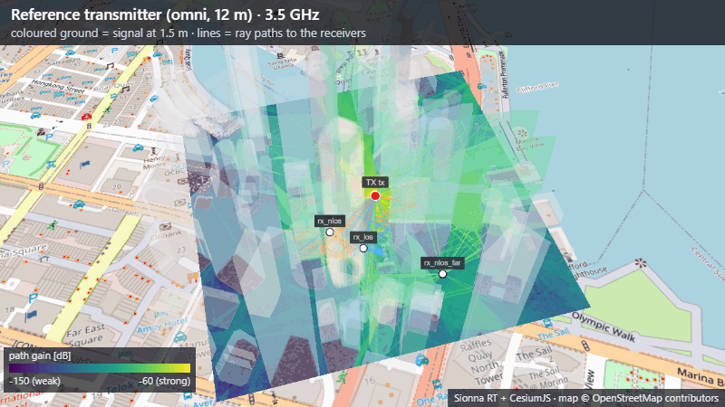 | 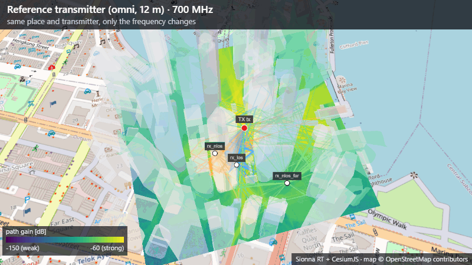 |
| **Coverage and ray paths at 3.5 GHz.** Coloured ground = signal strength at 1.5 m; lines = the paths the signal takes to three receivers. | **Same transmitter, 10 frequencies (700 MHz to 140 GHz).** The covered area shrinks as the frequency rises. |
| 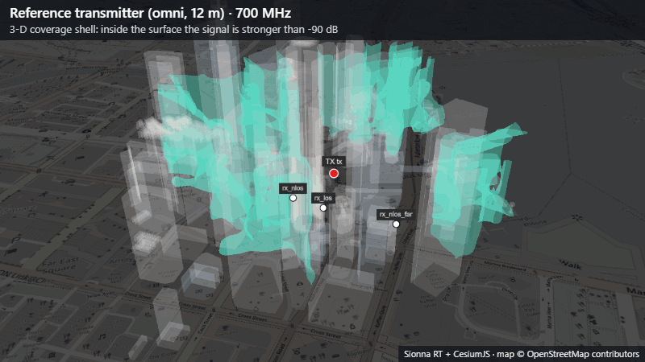 | 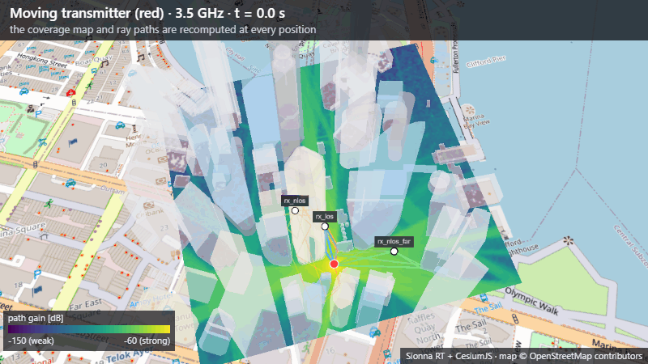 |
| **3-D coverage shells.** Inside the surface the signal is stronger than −90 dB: it fills the block at 700 MHz and is gone at 140 GHz. | **Moving transmitter.** Coverage and ray paths recomputed at 60 positions along the street. |

More animations (signal at height from 1.5 to 150 m, the rooftop macro, the mmWave small cell) are in the
[User Guide](docs/USER_GUIDE.md) (sections 10, 11, 12.4 and 12.6).

---

## Contents

1. [Terminology](#1-terminology)
2. [Architecture](#2-architecture)
3. [Data flow and file formats](#3-data-flow-and-file-formats)
4. [Quick start](#4-quick-start)
5. [Components](#5-components)
6. [GPU / OptiX under WSL2](#6-gpu--optix-under-wsl2)
7. [The frequency experiment](#7-the-frequency-experiment)
8. [Rebuild from scratch](#8-rebuild-from-scratch)
9. [Ports](#9-ports)
10. [Troubleshooting](#10-troubleshooting)
11. [Where this setup differs from the brief / the docs](#11-where-this-setup-differs-from-the-brief--the-docs)
12. [Next experiments](#12-next-experiments)
13. [Real-world scene and georeferencing](#13-real-world-scene-and-georeferencing)
14. [Singapore experiment: fixed and moving transmitter](#14-singapore-experiment-fixed-and-moving-transmitter)
15. [Geo exporter](#15-geo-exporter)
16. [CesiumJS viewer](#16-cesiumjs-viewer)
17. [Accuracy upgrade: materials, 10 bands, realistic transmitters](#17-accuracy-upgrade-materials-10-bands-realistic-transmitters)
18. [3-D coverage: shells and height slider](#18-3-d-coverage-shells-and-height-slider)

---

## 1. Terminology

**EM vs RF vs propagation simulation.**
*Electromagnetic (EM) simulation* is the umbrella term: solving Maxwell's equations (or an approximation) for
any frequency, geometry and purpose (antennas, circuits, scattering, radar, optics).
*RF simulation* narrows this to radio frequencies (roughly kHz to ~300 GHz) and usually to wireless use.
*Propagation simulation* is the part of RF simulation this stack does: how a signal gets from a transmitter to
a receiver through an environment. The outputs are path loss/gain, multipath components (delay, angle, phase),
coverage maps and channel impulse/frequency responses.

**Ray tracing vs full-wave methods.**

| | Full-wave (FDTD, FEM, MoM) | Ray-based / asymptotic (GO + UTD/GTD, "ray tracing") |
|---|---|---|
| Physics | Solves Maxwell's equations on a discretised domain | High-frequency approximation: fields travel along rays; reflection/refraction/diffraction coefficients at interactions |
| Accuracy | "Exact" up to discretisation | Good when objects are large relative to the wavelength (λ = 8.6 cm at 3.5 GHz, 1.1 cm at 28 GHz) |
| Cost | Grows with (size/λ)³ or worse; a city block at 28 GHz is out of reach | Grows with scene complexity and number of rays; city scale in milliseconds to seconds on a GPU |
| Typical use | Antennas, PCBs, packages, small scatterers, near field | Urban/indoor coverage, channel modelling, network planning, digital twins |

**Why ray tracing here:** the question is about city-scale propagation at 0.7–28 GHz, where buildings are
10²–10⁴ wavelengths across. That's exactly the regime where asymptotic methods are accurate and full-wave methods
are infeasible.

**Naming: Sionna "RT" and AODT "EM solver".** Sionna RT's "RT" means *ray tracing*: the method. NVIDIA AODT
(Aerial Omniverse Digital Twin) calls its propagation engine an "EM solver": the physics it approximates. Both
describe the same kind of simulation: a GPU ray tracer computing electromagnetic propagation paths
(LoS, reflection, diffraction, scattering) with frequency-dependent material models. AODT's EM engine is also a
ray-based solver, not a full-wave one.

## 2. Architecture

**Where everything runs** (purple = this project's code, teal = third-party simulation software, grey =
system):

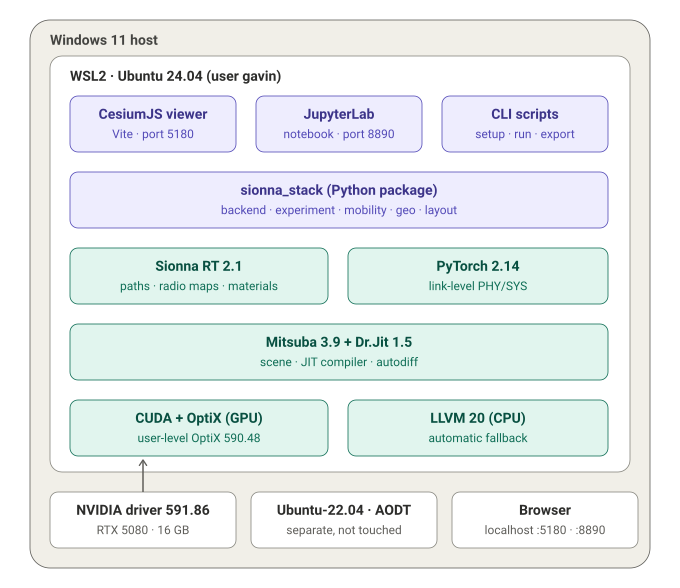

**How data moves** from the real map to the browser:

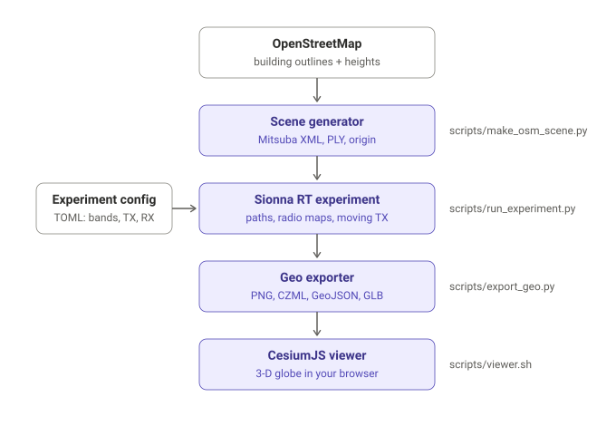

The same architecture in detail (Mermaid source, rendered by GitHub and VS Code with a Mermaid extension):

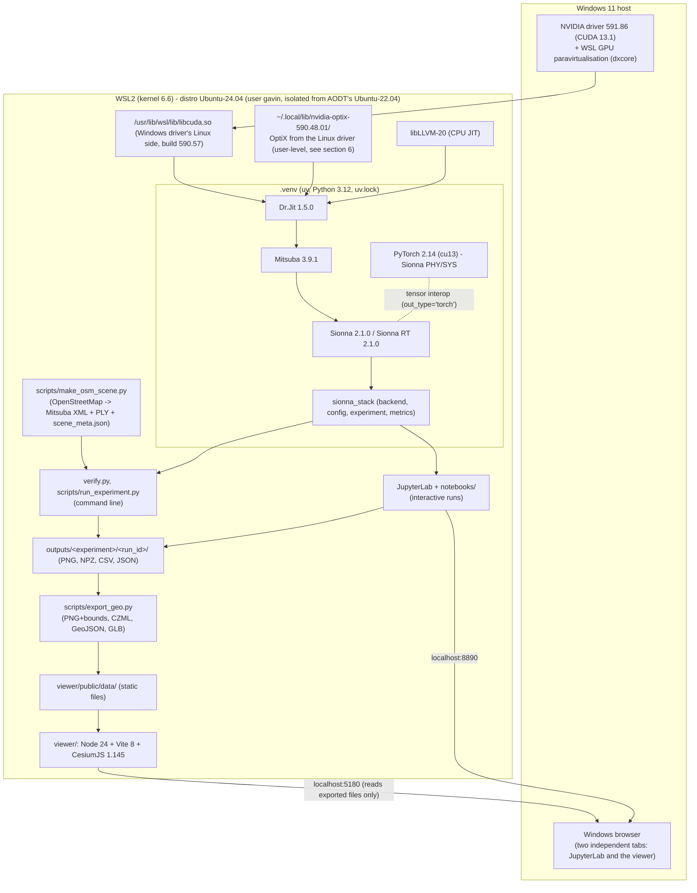

Layer by layer:

| Layer | What it does | Why it's needed |
|---|---|---|
| Windows NVIDIA driver 591.86 | Owns the GPU; exposes it to WSL2 via the dxcore paravirtualisation layer | WSL2 has no native GPU driver; CUDA calls are forwarded to Windows |
| WSL2 | Lightweight Linux VM | Sionna targets Linux (Ubuntu 24.04 recommended) |
| Ubuntu-24.04 distro | Dedicated OS for this stack | Sionna's recommended OS; isolation from the AODT distro (Ubuntu-22.04) |
| uv + `.venv` | Reproducible Python env from `uv.lock` | Exact versions everywhere; no system Python changes |
| PyTorch | Tensor library for Sionna PHY/SYS (link level) | Full `sionna` depends on it; RT outputs convert to torch tensors |
| Sionna RT | Radio propagation: scenes, radio devices, materials, `PathSolver`, `RadioMapSolver` | The simulation engine |
| Mitsuba 3 | Scene representation, geometry, rendering | Sionna RT is built on it |
| Dr.Jit | JIT compiler + autodiff; generates GPU (CUDA/OptiX) or CPU (LLVM) kernels | Runs every ray-tracing kernel |
| CUDA/OptiX or LLVM | Execution backend | OptiX = GPU ray/mesh intersection; LLVM = CPU fallback |
| `sionna_stack` | Backend selection, config-driven experiments, mobility, metrics, georeferencing, layout | Makes runs repeatable and scene-agnostic |
| Scene generator | OSM footprints → extruded buildings → Sionna scene with a known WGS84 origin | Built-in scenes have no geographic reference |
| Geo exporter | Local results → WGS84 web formats | Cesium (and GIS tools) work in lon/lat/height |
| Node.js + Vite + CesiumJS | Static web app showing exported files on a 3-D globe | Sionna has no globe frontend |

## 3. Data flow and file formats

```
scene creation              simulation (per band, + per step)        outputs                          export                viewer
--------------------   ->   ---------------------------------   ->   ----------------------------  ->  -----------------  ->  ---------
OSM (Overpass JSON)         scene.frequency = f                      band_<f>/paths.npz               export.json           CesiumJS
 -> scene.xml + PLY         PathSolver -> Paths                      band_<f>/radio_map.npz           radiomap_<f>.png      (browser,
 + scene_meta.json          RadioMapSolver -> PlanarRadioMap         band_<f>/mobility_*.npz          paths_<f>.czml         :5180)
   (WGS84 origin)           moving TX: repeat per route step         mobility/*.csv/.png/.gif         mobility_<f>.czml
or built-in scene           metrics (NumPy)                          metrics.csv/.md, manifest.json   devices.czml/.geojson
configs/*.toml                                                                                        scene/buildings.glb
```

| Step | Input | Output | Format |
|---|---|---|---|
| OSM download | lat/lon/size | `scenes/<name>/osm_raw.json` (snapshot, reusable with `--from-cache`) | Overpass JSON |
| Scene generation | OSM snapshot | `scene.xml`, `meshes/buildings.ply`, `meshes/ground.ply`, `scene_meta.json` | Mitsuba 3 XML, PLY, JSON |
| Scene | `builtin:<name>` or `scene.xml` (+ `meshes/*.ply`) | `sionna.rt.Scene` | Mitsuba 3 XML, PLY meshes |
| Config | `configs/<experiment>.toml` | `ExperimentConfig` | TOML |
| Paths | Scene + TX/RX | `paths.npz`: `a` [rx, rx_ant, tx, tx_ant, path, t] complex, `tau` [rx, tx, path] s, `valid`, `interactions` [depth, rx, tx, path], `vertices` [depth, rx, tx, path, 3] m | NumPy `.npz` |
| Radio map | Scene + TX | `radio_map.npz`: `path_gain` [tx, y, x] linear, `cell_centers` [y, x, 3] m, grid metadata | NumPy `.npz` |
| Figures | Paths, radio map | `radio_map_sionna.png`, `scene_radio_map.png`, `scene_paths.png`, comparisons | PNG |
| Tables | Paths, radio map | `metrics.csv/.md`, `radio_map_stats.csv` | CSV, Markdown |
| Mobility | Scene + route | `mobility_radio_maps.npz` [step, y, x], `mobility_paths.npz` (per step), `mobility/*.csv/.png/.gif` | NPZ, CSV, PNG, GIF |
| Manifest | All of the above | Config, backend, versions, timings, geo origin, mobility, warnings, file list | JSON |
| Export | Run dir (georeferenced) | `viewer/public/data/<exp>/<run>/…` + `index.json` | PNG + bounds, CZML, GeoJSON, glTF (GLB), JSON |

Simulation coordinates are the scene's local Cartesian frame in metres (z up). For generated scenes this is the
East-North-Up frame at the WGS84 origin in `scene_meta.json`; the exporter converts to lon/lat/height (§13).

## 4. Quick start

Inside the Ubuntu-24.04 distro (`wsl -d Ubuntu-24.04`):

```bash
cd ~/projects/sionna-stack
```

```bash
./setup.sh
```

```bash
uv run verify.py
```

```bash
uv run scripts/run_experiment.py configs/munich_frequency.toml
```

```bash
./scripts/jupyter.sh
```

Then open the printed `http://127.0.0.1:8890/lab?token=...` URL in a Windows browser and run
`notebooks/frequency_experiment.ipynb`.

Singapore experiment → globe viewer (the scene is already in `scenes/`; regenerate with §13):

```bash
uv run scripts/run_experiment.py configs/sg_raffles_place.toml
```

```bash
uv run scripts/export_geo.py outputs/sg_raffles_place/latest
```

```bash
./scripts/viewer.sh
```

Then open `http://localhost:5180` in a Windows browser.

Useful variants:

```bash
uv run verify.py --all-backends
```

```bash
uv run scripts/run_experiment.py configs/munich_frequency.toml --bands 0.7 3.5 28 --extrapolate-materials
```

```bash
SIONNA_STACK_BACKEND=llvm uv run scripts/run_experiment.py configs/munich_frequency.toml --quick
```

```bash
./scripts/gui.sh munich
```

## 5. Components

| Component | Version | Configured by | Run |
|---|---|---|---|
| Ubuntu (WSL2 distro) | 24.04.5 LTS | `/etc/wsl.conf` (`systemd=true`, `default=gavin`) | `wsl -d Ubuntu-24.04` |
| Python | 3.12.3 (system) | `.python-version`, `requires-python` | via uv |
| uv | 0.12.19 | `pyproject.toml`, `uv.lock` | `uv sync --frozen`, `uv run ...` |
| sionna (full) | 2.1.0 | pinned in `pyproject.toml` | library |
| sionna-rt | 2.1.0 | pinned | library |
| mitsuba / drjit | 3.9.1 / 1.5.0 | pinned (these are sionna-rt 2.1.0's own pins) | library |
| torch | 2.14.0 (CUDA 13 wheels) | `torch>=2.9.1`, locked | library |
| JupyterLab | 4.6.4 | `scripts/jupyter.sh` | port 8890 |
| OptiX (Linux driver files) | 590.48.01 | `tools/optix_wsl_userlevel.sh` | loaded by `sionna_stack.backend` |
| LLVM | libLLVM 20.1 (Ubuntu package `libllvm20`) | auto-detected by Dr.Jit | CPU fallback |
| sionna-rt-gui (optional) | 0.1.1 (isolated, pins sionna-rt 1.2.2) | `scripts/gui.sh`, `configs/gui_wsl.yaml` | WSLg window |
| pyproj / shapely / trimesh / mapbox-earcut / requests | 3.8.0 / 2.1.2 / 5.1.0 / 2.1.0 / locked | `uv.lock` | used by scene generator + exporter |
| Node.js | 24.21.0 LTS (user-level, `~/.local/opt`) | `tools/install_node.sh` (SHA-256 verified) | `node`, `npm` |
| CesiumJS | 1.145.0 | `viewer/package.json` + `package-lock.json` | viewer |
| Vite / vite-plugin-static-copy | 8.3.1 / 4.1.1 | `viewer/vite.config.js` | `./scripts/viewer.sh` (port 5180) |
| Cesium ion token (optional) | n/a | `viewer/.env` (git-ignored) | terrain + imagery + OSM Buildings |

### Why full `sionna` and not only `sionna-rt`

`sionna-rt` alone is enough for propagation. Full `sionna` adds PHY/SYS (link-level: OFDM, MIMO, channel
coding, 5G NR components) on PyTorch. Since link-level work may come later, the full package is locked now. That
way the environment doesn't change underneath existing results when PHY is added. The cost is disk (≈6 GB
`.venv`, mostly CUDA wheels for torch). If disk matters and PHY never will, replace `sionna==2.1.0` with only
`sionna-rt==2.1.0` in `pyproject.toml` and run `uv lock && uv sync`.

### Why uv

Sionna's guidance is "a Python virtual environment and/or Docker, then `pip install`". uv creates a standard venv
(`.venv/`) and installs the same PyPI wheels. It adds a cross-platform lockfile (`uv.lock`), so a rebuild gets
byte-identical versions. For a plain-pip rebuild, export the lock:
`uv export --frozen --no-hashes > requirements.txt`, then `python3 -m venv .venv && .venv/bin/pip install -r requirements.txt && .venv/bin/pip install -e .`.

### Repository layout

```
setup.sh                     idempotent setup + backend report
verify.py                    smoke test (paths + radio map, backend, timings; --all-backends compares CUDA vs LLVM)
pyproject.toml / uv.lock     pinned environment
src/sionna_stack/
  backend.py                 variant selection: CUDA/OptiX with LLVM fallback; WSL2 OptiX loading
  config.py                  TOML -> dataclasses (scene, bands, devices, solvers, grid, camera, mobility)
  experiment.py              the reusable per-band pipeline, figures, manifest
  mobility.py                moving-TX snapshots, gain-vs-time plot, animated radio maps
  layout.py                  receiver selection (LOS / NLOS / far NLOS) + route checks, any scene
  geo.py                     local ENU <-> WGS84 (exact PROJ pipeline)
  materials.py               ITU material frequency validity + opt-in extrapolation
  metrics.py                 path/delay/coverage metrics (definitions in the docstring)
configs/munich_frequency.toml  Phase 1 experiment (built-in scene)
configs/sg_raffles_place.toml  Phase 2 experiment (Singapore, fixed + moving TX)
configs/gui_wsl.yaml         sionna-rt-gui override for WSL2
scenes/sg_raffles_place/     generated scene: scene.xml, meshes/, scene_meta.json, osm_raw.json (OSM snapshot)
scripts/make_osm_scene.py    OSM -> georeferenced Sionna scene
scripts/suggest_layout.py    receiver positions + route check for any scene/TX
scripts/run_experiment.py    CLI for any config (static + mobility)
scripts/export_geo.py        run -> web/geo formats for the viewer
scripts/viewer.sh            CesiumJS viewer on 5180
scripts/jupyter.sh           JupyterLab on 8890
scripts/gui.sh               optional standalone GUI (isolated env)
tools/optix_wsl_userlevel.sh GPU enablement under WSL2 (section 6)
tools/install_node.sh        pinned Node.js LTS, user-level
viewer/                      index.html, src/{main,chart}.js, vite.config.js, package(-lock).json, .env.example
notebooks/frequency_experiment.ipynb
docs/                        USER_GUIDE, DEVELOPER_GUIDE, REBUILD_FROM_ZERO, img/
outputs/                     results (git-ignored; regenerate with the scripts)
viewer/public/data/          exported runs served to the viewer (git-ignored; regenerate with export_geo.py)
```

### Backend selection (`sionna_stack.backend`)

`import sionna.rt` selects the first Mitsuba variant that *imports* (`cuda_ad_mono_polarized`, else
`llvm_ad_mono_polarized`). Under WSL2 the CUDA variant imports but OptiX fails later, at the first scene load.
`backend.init()` therefore runs first. It loads the user-level OptiX files (section 6), sets the CUDA variant and
**proves** OptiX works by building a one-sphere scene. If that fails, it falls back to LLVM and records the reason.
Override with `SIONNA_STACK_BACKEND=auto|cuda|llvm` (or `--backend` on the scripts). Always call
`backend.init()` before `import sionna.rt`; `sionna_stack.experiment` does this on import.

## 6. GPU / OptiX under WSL2

**The problem.** Mitsuba's CUDA variants use OptiX for ray/mesh intersection. In WSL2,
`/usr/lib/wsl/lib/libnvoptix.so.1` is a 10 KB loader stub, and the real OptiX implementation (`nvoptix.bin` in
`/usr/lib/wsl/drivers/nv_dispig.inf_amd64_*/`) can't be loaded the standard Linux way. Result:

```
jit_optix_api_init(): libnvoptix.so.1 could not be loaded -- disabling OptiX backend!
RuntimeError: ... failed to instantiate scene plugin of type "scene": Could not initialize OptiX!
```

**Official fix (Mitsuba docs, [OptiX setup, WSL2](https://mitsuba.readthedocs.io/en/stable/src/optix_setup.html)).**
Extract the matching *Linux* driver and copy **five** files (`libnvoptix.so.*` → `libnvoptix.so.1`,
`libnvidia-ptxjitcompiler.so.*` → `.so.1`, `libnvidia-rtcore.so.*`, `libnvidia-gpucomp.so.*`, `nvoptix.bin`) into
`C:\Windows\System32\lxss\lib`, symlink `libcuda.so` into `/usr/lib/x86_64-linux-gnu/`, then `wsl --shutdown`.

**What this stack does instead (no Windows system folder, no sudo).**
`tools/optix_wsl_userlevel.sh` downloads the Linux driver, verifies its embedded checksum
(`--check`), extracts it (`--extract-only`, **never installed**) and copies the same five files to
`~/.local/lib/nvidia-optix-<ver>/`. `sionna_stack.backend` preloads the three companion libraries
(`gpucomp`, `ptxjitcompiler`, `rtcore`) with `ctypes` (`RTLD_GLOBAL`) and sets `DRJIT_LIBOPTIX_PATH`. This works in
scripts and in Jupyter kernels, and it affects only this project's processes. Verified:

| Attempt | Result |
|---|---|
| As installed (WSL stub) | `Could not initialize OptiX!` |
| `DRJIT_LIBOPTIX_PATH` only | `OPTIX_ERROR_UNKNOWN` (companion libraries not found) |
| `DRJIT_LIBOPTIX_PATH` + `LD_LIBRARY_PATH` (all five files) | works |
| `DRJIT_LIBOPTIX_PATH` + `ctypes` preload (what `backend.py` does) | works |

**Which Linux driver matches?** The Windows driver version (591.86) is not a Linux version. `nvidia-smi` inside
WSL shows the Linux-side build (`NVIDIA-SMI 590.57`), but NVIDIA publishes no Linux 590.57 `.run` (HTTP 404).
The closest public same-branch (R590) Linux driver is **590.48.01**
(`https://us.download.nvidia.com/XFree86/Linux-x86_64/590.48.01/NVIDIA-Linux-x86_64-590.48.01.run`, 396 MB).
It works with the 590.57 `libcuda`. To find the right one after a driver update:

```bash
nvidia-smi | head -4
```

Take the branch from `NVIDIA-SMI 5xx.yy` and pick the newest Linux driver of that branch from
`https://download.nvidia.com/XFree86/Linux-x86_64/` or `https://www.nvidia.com/en-us/drivers/`.

**Redo after every Windows GPU driver update** (the extracted files must stay compatible with WSL's `libcuda`):

```bash
bash tools/optix_wsl_userlevel.sh 590.48.01
```

(Replace the version with the match for the new driver.) `setup.sh` warns when the branch of the OptiX files
differs from the driver's.

**Undo** (nothing outside your home directory was changed):

```bash
rm -rf ~/.local/lib/nvidia-optix-* ~/nvidia-driver
```

**If you ever prefer the official lxss route** (system-wide, affects all distros): run the Mitsuba commands
above in WSL, copy `driver-dist/*` into `C:\Windows\System32\lxss\lib` as Administrator, run `wsl --shutdown`
(note: this also stops Docker Desktop/AODT). To undo, delete exactly those five files from `lxss\lib` and run
`wsl --shutdown`. Windows restores the stub on the next driver install. Not needed for this stack.

**Docker.** Docker Desktop's WSL GPU passthrough doesn't expose OptiX to containers (confirmed with AODT).
A container could mount the user-level folder and set the same variables, but this hasn't been tested, so Docker
is treated as experimental and not provided (see §16, "Optional: Docker / devcontainer").

**Performance warning.** Mitsuba: *"Using CUDA and OptiX through WSL degrades performance. Please do not collect
performance data within WSL."* Timings printed by this stack are for orientation only. On repeat runs, Dr.Jit's
kernel cache (`~/.drjit`) removes JIT compilation time, which is why second runs are much faster.

## 7. The frequency experiment

**Setup** (`configs/munich_frequency.toml`): built-in Munich scene (Sionna's tutorial scene; materials: marble,
metal, concrete, wood, brick). One transmitter at (8.5, 21, 27) m, 44 dBm, isotropic, V-polarised. Three
receivers at 1.5 m: `rx_los` (0, 100), `rx_nlos` (−90, 20), `rx_nlos_far` (−160, 40). They were chosen with
visibility ray tests; the run reports the measured LoS flag. Solvers: `PathSolver(deterministic=True)` and
`RadioMapSolver`, max depth 5, LoS + specular reflection + refraction + **diffraction**. Radio map: 500 × 500 m at
1.5 m height, 2 m cells, 10⁷ rays. Shared colour scale −150…−60 dB. Only `scene.frequency` changes between bands.

**Results (GPU run, `outputs/munich_frequency/<run_id>/metrics.md`):**

| band | rx | LoS | paths | strongest path gain [dB] | total path gain [dB] | RX power [dBm] | RMS delay spread [ns] |
|---|---|---|---|---|---|---|---|
| 3.5 GHz | rx_los | yes | 203 | −81.8 | −81.1 | −37.1 | 124.3 |
| 3.5 GHz | rx_nlos | no | 8 | −113.1 | −110.5 | −66.5 | 11.4 |
| 3.5 GHz | rx_nlos_far | no | 9 | −107.1 | −106.0 | −62.0 | 118.8 |
| 28 GHz | rx_los | yes | 261 | −99.8 | −98.6 | −54.6 | 122.4 |
| 28 GHz | rx_nlos | no | 9 | −146.2 | −143.6 | −99.6 | 5.3 |
| 28 GHz | rx_nlos_far | no | 10 | −148.6 | −144.9 | −100.9 | 5.8 |

| band | cells reached by rays | coverage (path gain > −130 dB) | median path gain (reached cells) |
|---|---|---|---|
| 3.5 GHz | 36.2 % | 32.2 % | −97.8 dB |
| 28 GHz | 33.3 % | 19.7 % | −126.0 dB |

(Cells not reached are either inside buildings, which the 1.5 m horizontal plane cuts through, or in shadow
regions that no ray reaches within 5 interactions.)

**Interpretation.**
* **LoS:** 28 GHz is 17.5 dB below 3.5 GHz, close to 20·log10(28/3.5) = 18.1 dB. With isotropic antennas, the
  receive aperture scales with λ², so free-space path gain drops by that amount (Friis).
* **NLoS:** the gap grows to 33–39 dB. Diffraction loss increases with frequency (the diffracted field decays
  faster away from the shadow boundary), so energy reaching shadowed streets collapses at 28 GHz.
* **Delay spread:** at `rx_nlos_far`, the 3.5 GHz channel has a strong early component (645 ns, −107 dB) that
  vanishes at 28 GHz, so the RMS delay spread drops from 119 ns to 6 ns. Fewer significant paths survive at mmWave.
* **CPU vs GPU consistency:** `verify.py --all-backends` gives identical total path gain (Δ = 0.000 dB) on both
  backends. Path counts differ by one (38 vs 37), a negligible path at the edge of the numeric tolerance.

**Metric definitions** are in `src/sionna_stack/metrics.py`. Note: *mean excess delay* is measured from the
first valid path, however weak (e.g. a −195 dB path at `rx_nlos`, 28 GHz). RMS delay spread is power-weighted
and unaffected.

**700 MHz.** Built-in scenes use ITU-R P.2040 materials whose tabulated ranges start at 1 GHz
(concrete/metal 1–100 GHz, brick 1–40 GHz, marble 1–60 GHz; ground types only 1–10 GHz). Sionna raises
`ValueError: Properties of ITU material 'marble' are not defined for this frequency`. The runner stops with a clear
message unless `--extrapolate-materials` (or `extrapolate_materials = true`) is given. It then evaluates each
material's ITU power law with the nearest range's coefficients, and `manifest.json` records a warning. Treat
700 MHz results as indicative only. (Sanity check: the 700 MHz LoS gain is 14 dB above 3.5 GHz, i.e.
20·log10(5).)

**Outputs** (`outputs/munich_frequency/<YYYYmmdd-HHMMSS>/`, plus `latest` → newest):
`comparison_radio_maps.png` (bands side by side, shared scale, plus the difference map), `path_gain_cdf.png`,
`power_delay_profiles.png`, `metrics.csv/.md`, `radio_map_stats.csv`, `manifest.json`, and per band
`band_<f>/radio_map_sionna.png` (Sionna `RadioMap.show`), `scene_radio_map.png` (Sionna 3-D render with
coverage overlay), `scene_paths.png`, `paths.npz` and `radio_map.npz`.

**Any scene, any bands.** Copy the config, change `[scene] source` to `builtin:<name>` or a Mitsuba XML path, set
`[bands] ghz`, and adapt the positions and camera. No code changes are needed.

**Standalone GUI (`sionna-rt-gui`) evaluation.** Works as an optional viewer, with caveats:
it pins `sionna-rt==1.2.2` (conflicts with 2.1.0), so `scripts/gui.sh` runs it isolated via `uvx`. Under WSL2 its
CUDA mode crashes (`CUDA_ERROR_OPERATING_SYSTEM ... gl_interop.cpp`: CUDA↔OpenGL interop isn't supported on
WSL), and in LLVM mode it hits an OptiX-denoiser bug. The launcher therefore uses the LLVM variant plus
`configs/gui_wsl.yaml` (`use_denoiser: false`), and it runs stably through WSLg. The notebook's `scene.preview()`
(GPU, same Sionna version) is the primary interactive view.

## 8. Rebuild from scratch

The complete, command-by-command manual (including how to **remove** everything first, and what to do without
Claude Code) is **[docs/REBUILD_FROM_ZERO.md](docs/REBUILD_FROM_ZERO.md)**. In short:

1. Windows: `wsl --install -d Ubuntu-24.04`, create a Linux user, make it the default.
2. Ubuntu: `sudo apt install -y libatomic1 git curl`, get the project (git clone or a backup copy).
3. `./setup.sh` (installs uv and the locked Python environment), `bash tools/optix_wsl_userlevel.sh 590.48.01`
   (GPU), `bash tools/install_node.sh` (viewer).
4. Check: `uv run verify.py --all-backends`, run the experiments, export, open the viewer.

Keep the project on the Linux filesystem (`~/...`), not `/mnt/c`, for I/O speed and correct permissions.

## 9. Ports

| Port | Service | Notes |
|---|---|---|
| 8890 | JupyterLab (`scripts/jupyter.sh`, `JUPYTER_PORT` to change) | bound to 127.0.0.1; reachable from Windows via WSL localhost forwarding |
| 5180 | CesiumJS viewer (`scripts/viewer.sh`, Vite dev server, `strictPort`) | bound to 127.0.0.1; open `http://localhost:5180` in Windows |
| avoided | 8888 (Jupyter default), 9000, 9001, 19120, 50051, 7233 (NVIDIA AODT) | |

## 10. Troubleshooting

| Symptom (actual message) | Cause | Fix |
|---|---|---|
| `ImportError: libatomic.so.1: cannot open shared object file` on `import drjit` | minimal Ubuntu image | `sudo apt install -y libatomic1` |
| `libnvoptix.so.1 could not be loaded -- disabling OptiX backend!` / `Could not initialize OptiX!` | WSL2 OptiX stub | section 6; the stack falls back to CPU meanwhile |
| `jit_optix_check(): API error 7999 (OPTIX_ERROR_UNKNOWN)` | OptiX found but companion libraries (rtcore/gpucomp/ptxjit) not | use `sionna_stack.backend.init()` or add the folder to `LD_LIBRARY_PATH` |
| `Properties of ITU material '...' are not defined for this frequency` | band outside ITU-R P.2040 validity | `--extrapolate-materials` (flagged) or custom `RadioMaterial` |
| `sionna_stack.backend.init() must be called before import sionna.rt` | variant already chosen by sionna | restart the kernel; call `init()` first |
| `wsl -d Ubuntu-24.04 -- ...` hangs with no output | distro not initialised / stuck | open the distro once interactively, or `wsl --terminate Ubuntu-24.04` (avoid `wsl --shutdown`, which stops Docker Desktop/AODT) |
| `getpwnam(<name>) failed` | placeholder left in `/etc/wsl.conf` | set `default=<real user>` |
| PowerShell: `The token '&&' is not a valid statement separator` | Linux command typed in Windows PowerShell 5.1 | run inside Ubuntu, or `wsl -d Ubuntu-24.04 -- bash -c "..."` |
| Inline `wsl.exe ... bash -c '...$VAR...'` expands too early / quoting errors | `wsl.exe` passes the command line through a shell again | put commands in a `.sh` file (LF endings) and run `wsl -d Ubuntu-24.04 -- bash file.sh` |
| Scripts edited from Windows lose `+x` | `\\wsl.localhost` writes reset the mode | `chmod +x setup.sh scripts/*.sh`, or call via `bash` |
| GUI: `CUDA_ERROR_OPERATING_SYSTEM ... gl_interop.cpp` | no CUDA↔GL interop in WSL2 | use `scripts/gui.sh` (LLVM variant) |
| GUI: `OptixDenoiser is only available in CUDA mode!` | GUI bug in LLVM mode | `configs/gui_wsl.yaml` (applied by `scripts/gui.sh`) |
| `504 Server Error: Gateway Timeout for url: https://overpass-api.de/api/interpreter` | public Overpass server busy | `make_osm_scene.py` retries and tries mirrors automatically; or rebuild from the snapshot with `--from-cache` |
| `jit_malloc(): out of memory! Could not allocate 4294967296 bytes (backend=CUDA…)` | too many receivers × samples in one PathSolver call | fewer receivers per call / fewer `samples_per_src` (`layout.py` batches 16 at a time) |
| Viewer: "An error occurred while rendering… The source image could not be decoded" | Cesium static files served as `index.html` (wrong paths) | `vite.config.js` must keep `rename: { stripBase: 4 }` (vite-plugin-static-copy ≥ 4) |
| Viewer: "No exports found" | nothing exported yet | `uv run scripts/export_geo.py outputs/<experiment>/latest`, then reload |
| Viewer: `Unexpected token '<', "<!doctype "... is not valid JSON` after exporting while it runs | Vite serves files created after start-up as `index.html` | fixed by `liveDataPlugin` in `viewer/vite.config.js` (keep it); with an old config, restart the viewer |
| Viewer: `Port 5180 is already in use` | another viewer instance running | stop it (Ctrl+C in its terminal) |
| Export: `... is not georeferenced` | built-in scene (no geographic origin) | use a scene made with `make_osm_scene.py` (§13) |

## 11. Where this setup differs from the brief / the docs

* **OptiX without touching `C:\Windows\System32\lxss\lib`:** a user-level variant of Mitsuba's procedure (same five
  files), so no Windows admin step and no effect on other distros (e.g. AODT's).
* **Mitsuba's guide copies five files, not only OptiX** (`rtcore`, `gpucomp`, `ptxjitcompiler`, `nvoptix.bin`).
* **No exact Linux match for Windows 591.86:** WSL reports Linux build 590.57, which isn't published; 590.48.01
  (same branch) works.
* **`libatomic1` was required** (not mentioned in the Sionna docs); `libllvm20` was already present.
* **`sionna-rt-gui` 0.1.1 pins sionna-rt 1.2.2** and needs the workarounds above under WSL2.
* **700 MHz** fails on every built-in scene (ITU material validity); only available as a flagged extrapolation.
* **28 GHz fails for scenes with ITU ground materials** (valid only 1–10 GHz). None of the built-in urban scenes use
  them; the scene generator therefore uses `concrete` for the ground by default.
* **Scene creation without Blender:** Sionna's documented route is Blender + Mitsuba-Blender add-on + Blosm (OSM).
  This stack uses a scripted Python generator that produces the same kind of scene (Mitsuba XML + PLY + ITU
  materials) in one repeatable command with an exact geographic origin (§13); the Blender route is documented as an
  alternative.
* **Cesium's official Vite example** targets an older `vite-plugin-static-copy`; with 4.x the Cesium folders must
  be copied with `rename: { stripBase: 4 }`, otherwise Cesium receives `index.html` instead of its assets.
* **Location:** the experiment area is Singapore (Raffles Place) as requested, not Munich; the built-in Munich
  scene remains the Phase 1 reference.
* Sionna's installation page has no WSL-specific notes; the brief's version facts (2.1.0, mitsuba 3.9.1,
  drjit 1.5.0, Python ≥3.10 for RT / ≥3.11 for full, PyTorch ≥2.9) are confirmed on PyPI.

## 12. Next experiments

Done since the first version: building materials from OSM tags with scattering, `building:part` volumes, 10 bands
from 700 MHz to 140 GHz, 3GPP antenna patterns with sectors and an 8×8 beam sweep (§17), the 3-D coverage volume
(§18). Still open:

* **Calibration against measurements:** phone or drive-test measurements (RSRP) at known points; tune the
  untagged-building material (the largest uncertainty, §17) until simulation and measurement agree.
* **Interference and SINR:** several sites on the same band, SINR instead of SNR maps, handover between the macro
  and the small cell.
* **Bandwidth / CFR:** `paths.cfr(subcarrier_frequencies(...))` for 100 MHz at 3.5 GHz vs 400 MHz at 28 GHz;
  frequency selectivity and coherence bandwidth from the delay spread.
* **Mobility (extend):** moving receivers (pedestrian/vehicle routes) and a fixed TX; time-varying CIR with
  `num_time_steps`; handover between two small cells; drone TX at rooftop height.
* **Scene:** trees and street furniture, terrain for hilly sites, a larger area around the site.
* **Link level:** feed `paths.cir(out_type="torch")` into Sionna PHY (OFDM, MIMO detection, BLER).

## 13. Real-world scene and georeferencing

### Why built-in scenes can't be georeferenced

Sionna's built-in scenes (Munich, Étoile, Florence, San Francisco, …) are Mitsuba XML + PLY meshes in an
arbitrary local metric frame. The files contain **no geographic metadata**: no origin, CRS, EPSG code or
lat/lon (checked: the only "geo"-like matches in `munich.xml` are building names such as "Georg-von-Vollmar-Haus").
The mesh origin and rotation relative to the real city are unknown, so any placement on a globe would be a guess.
The exporter therefore refuses them.

### Creating a scene from OpenStreetMap (the repeatable step)

```bash
uv run scripts/make_osm_scene.py --name sg_raffles_place --lat 1.2840 --lon 103.8514 --size 600
```

What it does (details in the script's docstring):

1. Queries the **Overpass API** for `building` ways/relations and `building:part` in a 600 m square around the
   origin. Retries and falls back to public mirrors (overpass-api.de, overpass.private.coffee, maps.mail.ru).
   The raw answer is saved as `scenes/<name>/osm_raw.json`, a **snapshot**: `--from-cache` rebuilds a
   byte-identical scene later (verified), even if OSM changes.
2. Converts footprints to local metres with `sionna_stack.geo.GeoFrame` (below).
3. Geometry (generator v2, OSM "Simple 3D Buildings"): outlines that contain `building:part` elements are replaced
   by those parts; every volume is extruded from its base (`min_height` / `building:min_level`) to its top
   (`height`, else `building:levels` × 3.2 m, else the outline's height, else 12 m). Raffles Place: 154 outlines +
   120 parts (26 outlines replaced by parts), 3–285 m.
4. Materials: `building:material` / `roof:material` → ITU materials (glass, concrete, marble for stone, metal,
   brick, wood); untagged volumes use `--default-material` (concrete). 85 volumes have a material tag (23 glass,
   22 stone, 12 metal, …). Each material has a thickness and a scattering coefficient for rough-surface
   scattering. One PLY per material (`meshes/bld_<material>.ply`), a concrete ground plane (`meshes/ground.ply`),
   and `scene.xml` in Sionna's format (material ids `rm_*`, see §17).
5. Writes `scene_meta.json`: origin, stats, OSM timestamp/query/licence, the exact command, known limitations.

Map data © OpenStreetMap contributors, ODbL 1.0.

**Alternative: Sionna's documented Blender route.** Blender + the Mitsuba-Blender add-on (exports Mitsuba XML)
+ the Blosm add-on (imports OSM/Google 3D cities), as shown in NVIDIA's video "Sionna RT: Scene Creation with
Blender using OpenStreetMap". It gives more modelling freedom (roof shapes, manual edits, materials per
surface) but is interactive, needs three extra installs (Blosm is distributed via Gumroad), and the geographic
origin must be recorded by hand (Blosm's scene origin). If you use it, check each add-on's README for the
supported Blender version, export with the Mitsuba add-on, and write a `scene_meta.json` with the origin so the
exporter can georeference the result. Not installed in this stack.

### Local frame ↔ WGS84 (`src/sionna_stack/geo.py`)

* Local frame = **East-North-Up** tangent plane at the origin (lat0, lon0, h0): x = east, y = north, z = up [m].
* Conversion = exact PROJ pipeline `+proj=cart` (geodetic → ECEF) + `+proj=topocentric` (ECEF → ENU), both
  directions. Round-trip error < 1e-9 m. Over 300 m the Earth's curvature drops the ground by ~7 mm, which the
  transform handles exactly.
* `h0` is the WGS84 **ellipsoidal** height of local z = 0. The generator writes 0 (true ground height unknown
  offline). The viewer adds the terrain height at the origin when Cesium World Terrain is on (§16).
* Radio-map images are placed on the lon/lat rectangle spanned by the ENU grid corners; over a few hundred metres
  the difference between the ENU grid and that rectangle is millimetres.

**Accuracy limits come from the data, not the maths:** OSM footprints typically ±1–5 m; heights from tags are
approximate and from levels/defaults are estimates; flat roofs; no terrain (flat ground at the origin height);
untagged buildings default to concrete (the largest remaining uncertainty below 6 GHz, see §17). Checked visually:
radio-map coverage and extruded buildings line up with the OpenStreetMap tiles in the viewer.

## 14. Singapore experiment: fixed and moving transmitter

`configs/sg_raffles_place.toml`, scene `scenes/sg_raffles_place` (origin 1.2840 N, 103.8514 E).

This is the **reference** experiment (idealised omni antenna, 10 bands); the realistic macro and small-cell
experiments are in §17.

* **Fixed TX:** small cell at 12 m in the Raffles Place plaza, 44 dBm, isotropic.
* **Receivers:** chosen with the same logic as Munich, now automated (`scripts/suggest_layout.py`,
  `src/sionna_stack/layout.py`) on the v2 scene: `rx_los` (−20, −80) 90 m, `rx_nlos` (−60, −40) 90 m,
  `rx_nlos_far` (75, −150) 160 m, all at 1.5 m.
* **Moving TX:** the same small cell on a vehicle at 3 m, driving 300 m along the straight street through the
  plaza at 10 m/s (30 s, 60 snapshots per band). The route was checked to stay outdoors.
* Settings: radio maps 1e9 rays, 10 interactions, diffuse scattering on; receiver values from the radio map
  (§17, Developer Guide §21).

Results (run `20260927-220617`), signal at the receivers:

| band | rx_los (in view) | rx_nlos (hidden, 90 m) | rx_nlos_far (hidden, 160 m) | outdoor area with SNR > 0 dB |
|---|---|---|---|---|
| 700 MHz | −66.6 dB | −76.4 dB | −89.3 dB | 99.9 % |
| 3.5 GHz | −80.9 dB | −94.6 dB | −104.9 dB | 98.8 % |
| 28 GHz | −100.8 dB | −117.4 dB | −126.9 dB | 49.3 % |
| 140 GHz | −115.4 dB | −131.7 dB | −141.1 dB | 19.5 % |

Moving TX: max |Doppler| = f·v/c exactly (23.3 Hz at 700 MHz, 116.7 Hz at 3.5 GHz, 934 Hz at 28 GHz,
4.67 kHz at 140 GHz, for 10 m/s). Median 28-vs-3.5 GHz gap along the route: 18.5 dB (`rx_los`), 24.4 dB
(`rx_nlos`), 20.7 dB (`rx_nlos_far`); `rx_nlos` and `rx_nlos_far` see the vehicle for 8 % of the route each.
(Mobility values are path-based: specular + diffraction, see Developer Guide §21.)

**Interpretation, compared with Munich:** in Munich the NLOS gap between 3.5 and 28 GHz was 33–39 dB
(diffraction-dominated, low buildings). In Raffles Place it stays at 20–23 dB: 150–285 m towers form reflective
street canyons that carry energy by reflection and scattering, which loses little extra at 28 GHz. The frequency
penalty depends strongly on the urban form, a key reason to simulate the real site. Earlier versions of this
table (simplified geometry, smooth concrete, 1e7 rays) gave e.g. −107.8 dB for `rx_nlos` at 3.5 GHz; the
upgraded model gives −94.6 dB: 13 dB difference from modelling choices alone (§17).

Outputs (in addition to §7's): `mobility/mobility_metrics.csv` (per band, step, receiver, incl. Doppler),
`mobility/mobility_path_gain.png`, `mobility/mobility_radio_maps.gif`, `mobility/mobility.json`,
`band_*/mobility_radio_maps.npz`, `band_*/mobility_paths.npz`.

## 15. Geo exporter

```bash
uv run scripts/export_geo.py outputs/sg_raffles_place/latest
```

Writes `viewer/public/data/<experiment>/<run_id>/` (one folder per simulation run = versioned) and refreshes
`viewer/public/data/index.json`:

| File | Content | Format |
|---|---|---|
| `export.json` | manifest: bands, file names, radio-map rectangles, legend, per-band metrics, mobility timeline + series, backend, versions, warnings, accuracy notes | JSON |
| `radiomap_<band>.png` | path-gain map, viridis on the shared scale, transparent where no ray arrived; north up | PNG (+ bounds in `export.json`) |
| `paths_<band>.czml` | strongest 60 paths per receiver as 3-D polylines (colour = receiver; opacity and width = path gain), grouped per receiver; popup: gain, delay, interactions | CZML |
| `devices.czml` / `devices.geojson` | TX and RX points; popups/properties with per-band metrics | CZML / GeoJSON |
| `mobility_<band>.czml` | moving TX (time-sampled position + trail) and 8 strongest paths per receiver per snapshot (availability intervals) | CZML (time-dynamic) |
| `mobility/<band>/rm_###.png` | radio-map frame per snapshot | PNG |
| `scene/buildings.glb` | simulation buildings (glTF is Y-up: stored as east, up, −north) | glTF 2.0 binary |

Heights are relative to the scene ground (`h0`); the timeline uses an arbitrary epoch (2026-01-01T00:00:00Z),
not a real date. **How new runs appear in the viewer:** run an experiment → export it → reload the browser page;
the new run is listed first in "Simulation run". Old exports stay until you delete their folders.

## 16. CesiumJS viewer

```bash
./scripts/viewer.sh
```

Opens on `http://localhost:5180`. It's a static web app (no backend): it only reads `viewer/public/data/`.
Runs inside Ubuntu with the Linux Node 24 from `tools/install_node.sh` (the Windows Node isn't used, because
serving files from the Linux filesystem to a Windows process is slow and unreliable).

* **Fixed TX tab:** band buttons (every band of the run, up to 10) with one shared colour legend, radio-map on/off
  and opacity, ray paths toggled per receiver (one colour per receiver), TX/RX markers with popups (LOS, paths,
  path gain, RX power, SNR), link-metrics table (SNR and Shannon capacity for the realistic runs), building
  materials key.
* **3-D coverage** (Fixed TX tab, runs with a volume): coverage shells per level and the signal map floating at a
  chosen height, 1.5–150 m (§18).
* **Moving TX tab:** Cesium timeline and play button; the TX moves along its route with a trail, the radio map
  and paths change per snapshot, and a chart shows total path gain vs time for each receiver with a cursor
  (dots = LoS).
* **Camera:** Top view / 3D view buttons; building opacity slider.
* **Base maps** (`Base map` selector or `?base=` URL parameter):
  * `osm` (default without token): OpenStreetMap raster tiles (online, no account). Please respect the OSM tile
    usage policy (light interactive use only).
  * `offline`: Natural Earth II imagery bundled with CesiumJS; works without internet (verified: only localhost
    requests).
  * `ion`: Cesium World Imagery + **Cesium World Terrain** + optional **Cesium OSM Buildings**; needs a Cesium ion
    access token. Create a free account at `https://ion.cesium.com`, create a token, then put it in
    `viewer/.env` (copy `viewer/.env.example`; the file is git-ignored, never commit it) and restart the viewer.
    With terrain on, everything is lifted by the terrain height at the scene origin.
* **Terrain + 3D buildings without a token:** not available (both are ion services); the no-token modes show a
  plain ellipsoid plus the simulation scene's own buildings, which is what the simulation actually used.
* Credits/provenance (backend, versions, accuracy, ground offset, OSM attribution) are shown at the bottom of the
  panel. For debugging, `sionnaViewer` in the browser console exposes the viewer state.
* **Recording mode** for the documentation GIFs: open `http://localhost:5180/?record=all`, then
  `uv run scripts/make_gifs.py` (details: Developer Guide §24).

## 17. Accuracy upgrade: materials, 10 bands, realistic transmitters

Goal: results as close to a real deployment as possible without measurements. What changed:

| Area | Before | Now |
|---|---|---|
| Buildings | one extruded block per footprint, all concrete | OSM `building:part` volumes (podiums, setbacks), materials from OSM tags (glass, stone, metal, concrete), wall and roof materials separate (scene generator v2) |
| Surfaces | perfectly smooth | diffuse scattering with per-material roughness (scattering coefficients) |
| Bands | 3.5 / 28 GHz | 700 MHz, 900 MHz, 1.8, 2.1, 2.6, 3.5, 7.5, 28, 39, 140 GHz with typical channel bandwidths |
| Transmitters | one isotropic antenna, 44 dBm | isotropic reference **plus** a 3-sector rooftop macro (3GPP panel, downtilt, 46 dBm/sector) and a mmWave lamppost small cell (8×8 array, 18-beam sweep, ~56 dBm EIRP) |
| Numerics | 1e7 rays, depth 5 | 1e9 rays, depth 10 for maps (proven converged); link paths depth 10 |
| Outputs | path gain | + received power, SNR, Shannon capacity bound, best-server/best-beam maps, frequency-sweep chart, % of **outdoor** area covered |
| Uncertainty | none stated | convergence study + sensitivity study (material and roughness assumptions) |

**Three experiments** (all Raffles Place, same scene):

| Config | Question it answers |
|---|---|
| `configs/sg_raffles_place.toml` | Pure physics: what does frequency alone do? (omni TX, 10 bands, moving TX) |
| `configs/sg_macro.toml` | What would a typical rooftop macro deliver in 700 MHz – 7.5 GHz? |
| `configs/sg_smallcell_mmwave.toml` | What would a street-level mmWave small cell deliver at 28 / 39 / 140 GHz? |

**New tools:**

```bash
bash tools/run_all_singapore.sh
```
runs all three experiments at full accuracy, exports them for the viewer and runs the sensitivity study (≈1 h;
log in `logs/`; `bash tools/follow_log.sh` shows progress).

```bash
uv run scripts/convergence_study.py configs/sg_raffles_place.toml --bands 0.7 3.5 28 140
```
checks that the ray count and number of interactions are high enough (method and results: Developer Guide §21).

```bash
uv run scripts/sensitivity_study.py configs/sg_raffles_place.toml --bands 0.7 3.5 28 140 --variants baseline=scenes/sg_raffles_place untagged_glass=scenes/sg_raffles_place_glass specular=scenes/sg_raffles_place_specular rough_x2=scenes/sg_raffles_place_rough2
```
shows how much the uncertain assumptions (material of untagged buildings, surface roughness) move the results.

**Sionna 2.1 pitfall found on the way:** material ids starting with `itu_` lose their `scattering_coefficient` on
loading (Developer Guide §21); generated scenes use `rm_*` ids.

### Results (full accuracy, runs of 2026-09-27)

Share of the **outdoor** area (500 × 500 m around the plaza) with SNR > 0 dB over the channel bandwidth:

| band | 700 MHz | 900 MHz | 1.8 | 2.1 | 2.6 | 3.5 | 7.5 | 28 | 39 | 140 GHz |
|---|---|---|---|---|---|---|---|---|---|---|
| reference (omni 44 dBm, 12 m) | 99.9 | 99.9 | 99.9 | 99.8 | 99.7 | 98.8 | 86.8 | 49.3 | 43.6 | 19.5 |
| rooftop macro (3 × 46 dBm, 47 m) | 100 | 100 | 99.9 | 99.9 | 99.8 | 99.5 | 96.4 | – | – | – |
| mmWave small cell (2 × 30 dBm, 18 beams, 6 m) | – | – | – | – | – | – | – | 46.4 | 42.1 | 15.4 |

Shannon capacity bound (upper limit, no interference) at the macro's line-of-sight receiver: 262 Mbit/s at
700 MHz (10 MHz), 448 at 1.8 GHz (20 MHz), 1,822 at 3.5 GHz (100 MHz), 2,901 at 7.5 GHz (200 MHz); small cell
at 28 GHz: 2,649 Mbit/s in view, 485 Mbit/s at the hidden receiver 160 m away.

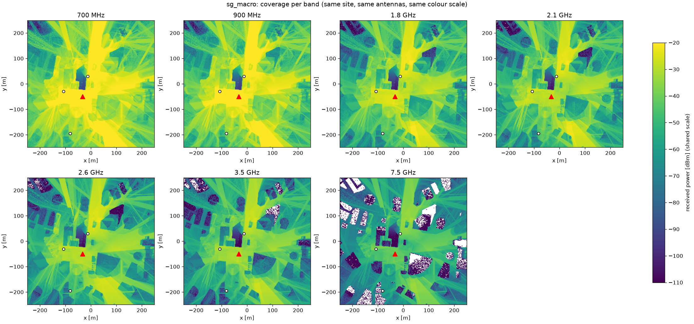

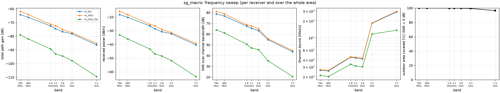

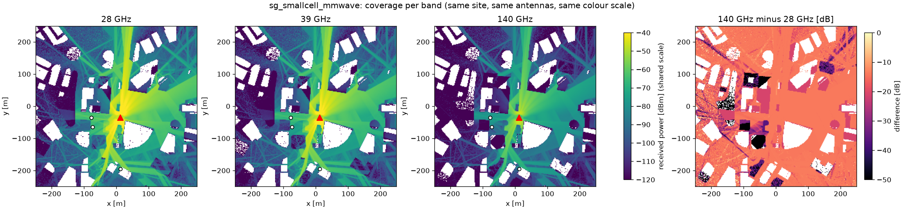

**Uncertainty** (sensitivity study, Developer Guide §22): if untagged buildings are glass instead of concrete,
signals below 6 GHz are ~6 dB stronger on average (thin glass lets them through buildings); surface roughness
changes mmWave coverage by up to ±7 percentage points. Receiver values move by 0–3 dB. Converged numerics
contribute ≈ 0.3 dB. Absolute values at individual spots should be treated as ±several dB until calibrated with
measurements; comparisons between bands and sites are more reliable.

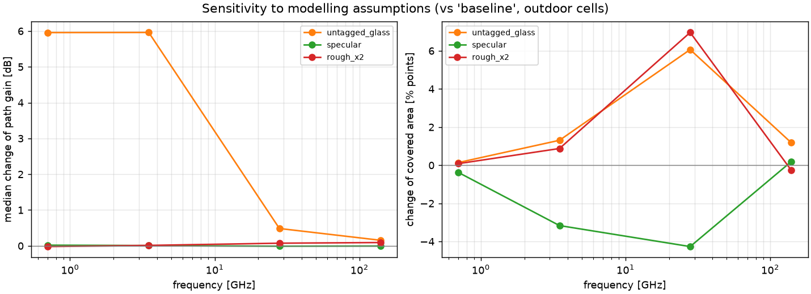

## 18. 3-D coverage: shells and height slider

The signal is also computed in 3-D: 31 heights (1.5 m, then every 5 m to 150 m) × 125 × 125 cells of 4 m, using
one Sionna mesh radio map made of stacked measurement sheets (validated against planar maps: median difference
0.04 dB; ≈ 10 s per band for the omni reference). From it the pipeline makes:

* `volume_slices.png`: a vertical cut through the transmitter for every band;
* `volume_shells_3d.png`: one coverage shell (a fixed signal level) per band, the 3-D pattern vs frequency;
* in the viewer (**3-D coverage**, Fixed TX mode): translucent **coverage shells** at three levels and the
  coloured map **floating at any height** (slider), switchable per band.

Add it to an existing run without re-simulating the rest:

```bash
uv run scripts/run_volume.py configs/sg_macro.toml outputs/sg_macro/latest
```

```bash
uv run scripts/export_geo.py outputs/sg_macro/latest
```

or for all three studies: `bash tools/run_all_volumes.sh` (≈ 20 min). To change only the shell levels (`[volume] shell_levels`), add `--figures-only` to `run_volume.py` (seconds, no GPU) and export again; `uv run python tools/volume_stats.py <run>` shows the value range to choose them from. Details: User Guide §12.6, Developer Guide §23.

**Optional: Docker / devcontainer.** Not provided. Docker Desktop's WSL GPU passthrough doesn't expose OptiX to
containers (confirmed with AODT), so a container would run on the CPU backend unless you mount
`~/.local/lib/nvidia-optix-*` and replicate `backend.py`'s preload, which is untested. The WSL distro + uv lock +
npm lock already give a reproducible environment; if you add a container, base it on `ubuntu:24.04`, install
`libatomic1`, uv, and run `uv sync --frozen` and `npm ci`.
