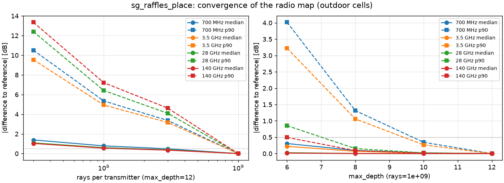

# Developer Guide: how the stack is built, and how to maintain and extend it

**Who this is for:** whoever maintains, rebuilds or extends this setup. Read the [User Guide](USER_GUIDE.md)
first for the concepts (paths, path gain, radio maps) and the [README](../README.md) for the reference tables.
This guide explains the *why* and *how* behind each piece, the internal contracts, and the procedures for
common changes.

---

## Contents

1. [Design principles](#1-design-principles)
2. [The layers, bottom to top](#2-the-layers-bottom-to-top)
3. [Repository map](#3-repository-map)
4. [Working on this project from Windows](#4-working-on-this-project-from-windows)
5. [The Python environment (uv)](#5-the-python-environment-uv)
6. [Backend selection and GPU/OptiX under WSL2](#6-backend-selection-and-gpuoptix-under-wsl2)
7. [The experiment pipeline, function by function](#7-the-experiment-pipeline-function-by-function)
8. [Sionna RT API used (verified against 2.1.0)](#8-sionna-rt-api-used-verified-against-210)
9. [Metrics: definitions and caveats](#9-metrics-definitions-and-caveats)
10. [Materials and frequency validity](#10-materials-and-frequency-validity)
11. [Output contract (for the Phase 2 exporter)](#11-output-contract-for-the-phase-2-exporter)
12. [How to… (common changes)](#12-how-to-common-changes)
13. [Verification and testing](#13-verification-and-testing)
14. [Known issues and workarounds](#14-known-issues-and-workarounds)
15. [Geo pipeline: scene generation and georeferencing](#15-geo-pipeline-scene-generation-and-georeferencing)
16. [Receiver layout helper](#16-receiver-layout-helper-layoutpy-scriptssuggest_layoutpy)
17. [Mobility pipeline](#17-mobility-pipeline-mobilitypy)
18. [Geo exporter](#18-geo-exporter-scriptsexport_geopy)
19. [Viewer internals](#19-viewer-internals-viewer)
20. [Phase 2 verification checklist](#20-phase-2-verification-checklist)
21. [Accuracy settings](#21-accuracy-settings-why-1e9-rays-depth-10-and-no-diffuse-link-paths)
22. [Sensitivity study and remaining uncertainty](#22-sensitivity-study-and-remaining-uncertainty)
23. [3-D signal volume](#23-3-d-signal-volume-coverage-shells-height-slider)
24. [Documentation GIFs (recording mode)](#24-documentation-gifs-recording-mode)

Rebuilding the machine by hand: [REBUILD_FROM_ZERO.md](REBUILD_FROM_ZERO.md).

---

## 1. Design principles

1. **Official docs are the source of truth.** Sionna changes fast (2.x moved to PyTorch; the RT API was
   reorganised in 1.x). Every API used here was checked against the installed 2.1.0 package with `inspect` and
   `help()`, not recalled from older versions (see §8). Keep doing that when upgrading.
2. **Replicable.** Exact versions in `uv.lock`; one config file per experiment; each run writes a
   `manifest.json` with config, backend, versions and git commit; outputs are append-only (one folder per run).
3. **Always runs.** GPU (CUDA/OptiX) when possible, automatic CPU (LLVM) fallback otherwise, with the reason
   recorded.
4. **No hidden system changes.** No sudo inside scripts (`setup.sh` *prints* apt commands instead), nothing
   written to Windows system folders, nothing that affects the AODT distro (`Ubuntu-22.04`) or Docker Desktop.
5. **Scene- and band-agnostic code.** Anything specific to Munich lives in `configs/munich_frequency.toml`,
   never in Python.
6. **Report honestly.** Warnings for extrapolated materials, measured (not assumed) LOS flags, WSL timing caveats.

## 2. The layers, bottom to top

| # | Layer | Version | Role | Configured in |
|---|---|---|---|---|
| 1 | Windows NVIDIA driver | 591.86 (CUDA 13.1) | owns the GPU; WSL's `libcuda` forwards to it | Windows |
| 2 | WSL2 | 2.6.1, kernel 6.6.87 | Linux VM with GPU paravirtualisation (`/dev/dxg`, `/usr/lib/wsl/lib`) | Windows |
| 3 | Ubuntu-24.04 distro | 24.04.5 | Sionna's recommended OS; user `gavin`; systemd on | `/etc/wsl.conf` |
| 4 | System libraries | `libatomic1`, `libllvm20` | Dr.Jit runtime deps (atomic ops; CPU JIT) | apt |
| 5 | OptiX user-level files | Linux driver 590.48.01 | real OptiX for WSL2 (§6) | `tools/optix_wsl_userlevel.sh` |
| 6 | Python + uv | 3.12.3 / uv 0.12.19 | interpreter + reproducible installs | `.python-version`, `pyproject.toml`, `uv.lock` |
| 7 | PyTorch | 2.14.0 (cu13 wheels) | tensor backend of Sionna PHY/SYS | locked |
| 8 | Dr.Jit | 1.5.0 | JIT compiler + autodiff; emits CUDA/OptiX or LLVM kernels | pinned |
| 9 | Mitsuba 3 | 3.9.1 | scene graph, BVH/intersection, rendering; "variants" pick backend + colour mode | pinned |
| 10 | Sionna RT | 2.1.0 | radio materials, antennas, `PathSolver`, `RadioMapSolver`, radio renders | pinned |
| 11 | Sionna (full) | 2.1.0 | adds PHY/SYS (link level) | pinned |
| 12 | `sionna_stack` | 0.1.0 (this repo) | backend init, config, experiment, metrics, materials | `src/sionna_stack/` |
| 13 | Entry points | | `setup.sh`, `verify.py`, `scripts/*.py`, notebook | |
| 14 | Geo libs | pyproj 3.8.0, shapely 2.1.2, trimesh 5.1.0, mapbox-earcut 2.1.0 | OSM scene generation, ENU↔WGS84, GLB | `uv.lock` |
| 15 | Node.js | 24.21.0 LTS | runs Vite for the viewer | `tools/install_node.sh` |
| 16 | CesiumJS + Vite | 1.145.0 + 8.3.1 | 3-D globe viewer (static web app) | `viewer/package(-lock).json`, `viewer/vite.config.js` |

**Mitsuba variants** used by Sionna RT: `cuda_ad_mono_polarized` (GPU) and `llvm_ad_mono_polarized` (CPU).
`ad` = automatic differentiation, `mono` = single wavelength (the radio frequency), `polarized` = full
polarisation (needed for EM reflection/diffraction coefficients). RGB variants are only used for picture renders.

## 3. Repository map

```
sionna-stack/
├── pyproject.toml, uv.lock, .python-version   environment definition (§5)
├── setup.sh                                   idempotent: checks, uv sync, driver/OptiX check, backend report
├── verify.py                                  smoke test; --all-backends compares CUDA vs LLVM (§13)
├── src/sionna_stack/
│   ├── __init__.py
│   ├── backend.py        variant selection + WSL2 OptiX loading (§6). Import FIRST.
│   ├── config.py         TOML → dataclasses (ExperimentConfig, PathsCfg, RadioMapCfg, RenderCfg, GeoOrigin)
│   ├── experiment.py     pipeline: build_scene, set_band, compute_paths, compute_radio_map, run_band,
│   │                     run_experiment, figures, manifest (§7)
│   ├── materials.py      ITU validity check + opt-in extrapolation (§10)
│   ├── metrics.py        link + radio-map metrics (§9)
│   ├── geo.py            GeoFrame: local ENU <-> WGS84 (§15)
│   ├── layout.py         receiver selection + route checks (§16)
│   └── mobility.py       moving-TX snapshots (§17)
├── configs/
│   ├── munich_frequency.toml   Phase 1 experiment (annotated)
│   ├── sg_raffles_place.toml   Singapore reference: omni TX, 10 bands, fixed + moving TX
│   ├── sg_macro.toml           Singapore: 3-sector rooftop macro, 700 MHz - 7.5 GHz
│   ├── sg_smallcell_mmwave.toml  Singapore: lamppost mmWave small cell, 8x8 array, 18 beams, 28/39/140 GHz
│   └── gui_wsl.yaml            sionna-rt-gui override (§14)
├── scenes/sg_raffles_place/    generated scene + OSM snapshot (tracked in git: it is an input)
├── scripts/
│   ├── make_osm_scene.py  OSM -> Sionna scene (§15, v2: parts + materials §21)
│   ├── convergence_study.py  rays / depth needed (§21)
│   ├── sensitivity_study.py  effect of modelling assumptions (§22)
│   ├── suggest_layout.py  receivers / route check for any scene (§16)
│   ├── run_experiment.py  CLI around experiment.run_experiment (static + mobility)
│   ├── export_geo.py      run -> viewer/public/data (§18)
│   ├── viewer.sh          CesiumJS viewer on 127.0.0.1:5180 (§19)
│   ├── jupyter.sh         JupyterLab on 127.0.0.1:8890
│   └── gui.sh             optional sionna-rt-gui in an isolated uvx env
├── tools/
│   ├── optix_wsl_userlevel.sh  download/verify/extract Linux driver OptiX files (§6)
│   ├── install_node.sh         pinned Node.js LTS, user-level (§19)
│   ├── run_all_singapore.sh    all Singapore studies + exports + sensitivity (§22)
│   ├── follow_log.sh / wait_for.sh   progress helpers for long runs
├── viewer/                index.html, src/main.js, src/chart.js, src/style.css, vite.config.js,
│                          package.json, package-lock.json, .env.example (public/data is generated)
├── notebooks/frequency_experiment.ipynb   interactive twin of the script (stored WITHOUT outputs)
├── docs/                  USER_GUIDE.md, DEVELOPER_GUIDE.md, REBUILD_FROM_ZERO.md, img/
└── outputs/               git-ignored; one folder per run (§11)
```

## 4. Working on this project from Windows

The project lives on the **Linux filesystem** (`/home/gavin/projects/sionna-stack`), not `/mnt/c`: file I/O is
much faster and Linux permissions/symlinks work. From Windows it's reachable as
`\\wsl.localhost\Ubuntu-24.04\home\gavin\projects\sionna-stack`.

Best option: work **inside** Ubuntu (a terminal, or VS Code with the WSL extension, or Claude Code started inside
the distro). If you drive it from Windows, know these pitfalls (all hit during the build):

* **Windows PowerShell 5.1 has no `&&`**, and mangles quotes in `wsl ... bash -c "..."`.
* **`wsl.exe` runs your command line through a shell once more**, so `$VAR`, `$(...)` and quotes in an inline
  command are expanded *before* your intended `bash -c` sees them. Reliable pattern: write a `.sh` file (LF line
  endings) and run `wsl -d Ubuntu-24.04 -- bash /home/gavin/.../file.sh`. From Git Bash also set
  `MSYS_NO_PATHCONV=1` so `/home/...` isn't rewritten to a Windows path.
* **Files written through `\\wsl.localhost` lose the executable bit.** Run `chmod +x setup.sh verify.py scripts/*
  tools/*` afterwards, or call scripts via `bash`/`uv run`. Git records the mode, so commits keep it.
* **Symlinks** (`outputs/<exp>/latest`) aren't reliably followed from Windows tools; use the dated folder.
* **Never `wsl --shutdown` casually**: it stops *all* distros, including Docker Desktop and AODT. Use
  `wsl --terminate Ubuntu-24.04`.

## 5. The Python environment (uv)

* `pyproject.toml` declares **direct** dependencies with pins for the ray-tracing core
  (`sionna==2.1.0`, `sionna-rt==2.1.0`, `mitsuba==3.9.1`, `drjit==1.5.0`) and lower bounds for the rest.
  The project itself is an installable package (`src/` layout, hatchling), so `import sionna_stack` works in
  scripts and notebooks.
* `uv.lock` pins **every** transitive package (147 entries, all platforms). `uv sync --frozen` installs exactly
  that and fails instead of re-resolving: this is what `setup.sh` runs.
* `.python-version` = 3.12 (system Python of Ubuntu 24.04; uv uses it rather than downloading one).

Common operations (inside the project):

```bash
uv add <package>
```
adds a dependency, updates `pyproject.toml` and `uv.lock`, and syncs.

```bash
uv lock --upgrade-package torch
```
upgrades one package within its constraints (then `uv sync --frozen`).

```bash
uv export --frozen --no-hashes > requirements.txt
```
produces a plain-pip requirements file for people who don't use uv.

**Upgrading Sionna** (e.g. to 2.2): read the release notes and the migration pages first; change the four pins
together (use the `mitsuba`/`drjit` versions that the new `sionna-rt` requires: check with
`curl -s https://pypi.org/pypi/sionna-rt/<ver>/json`), `uv lock`, `uv sync`, then run §13 fully and compare
`metrics.csv` against a previous run.

## 6. Backend selection and GPU/OptiX under WSL2

### 6.1 Why a custom backend module?

`sionna/rt/__init__.py` does:

```python
if mi.variant() is None:
    try:
        mi.set_variant("cuda_ad_mono_polarized", "metal_ad_mono_polarized", "llvm_ad_mono_polarized")
    except ImportError:
        mi.set_variant("llvm_ad_mono_polarized")
```

Under WSL2 the CUDA variant *imports* fine, so Sionna selects it, and then the first `load_scene()` dies with
`Could not initialize OptiX!`. No automatic fallback. Hence `sionna_stack.backend.init()` must run **before**
`import sionna.rt`:

```
init(prefer)                              prefer = arg or $SIONNA_STACK_BACKEND or "auto"
 ├─ if WSL2 and prefer in {auto,cuda} and DRJIT_LIBOPTIX_PATH not set:
 │     d = newest ~/.local/lib/nvidia-optix-*/ containing libnvoptix.so.1
 │     ctypes.CDLL(gpucomp, ptxjitcompiler, rtcore, RTLD_GLOBAL)   ← order matters
 │     os.environ["DRJIT_LIBOPTIX_PATH"] = d/libnvoptix.so.1
 ├─ import mitsuba                         (Dr.Jit reads DRJIT_LIBOPTIX_PATH lazily)
 ├─ try: set_variant(cuda); load_dict({"type":"scene", sphere})    ← proves OptiX builds an accel. structure
 │  except: prefer=="cuda" → raise with instructions; else fallback_reason = last error line
 ├─ else set_variant(llvm)
 └─ return BackendInfo(variant, backend, gpu, driver, optix_source, fallback_reason, versions)  (cached)
```

It's idempotent (the second call returns the cached result) and raises if `sionna.rt` was already imported.

**Why `ctypes` preloading instead of `LD_LIBRARY_PATH`?** The dynamic loader reads `LD_LIBRARY_PATH` only at
process start, so setting it from Python is too late, and Jupyter kernels would need a custom kernel spec.
Preloading with `RTLD_GLOBAL` registers the libraries by their soname; when `libnvoptix` later `dlopen`s
`libnvidia-rtcore.so.590.48.01`, the loader finds it already loaded. Verified results:

| Configuration | Result |
|---|---|
| WSL default (stub `libnvoptix.so.1`) | `Could not initialize OptiX!` |
| `DRJIT_LIBOPTIX_PATH` only | `OPTIX_ERROR_UNKNOWN` (companions not found) |
| `DRJIT_LIBOPTIX_PATH` + `LD_LIBRARY_PATH` | OK (used by `scripts/gui.sh`, a separate process) |
| `DRJIT_LIBOPTIX_PATH` + ctypes preload | OK (used by `backend.py`) |

### 6.2 The OptiX files: where they come from

`tools/optix_wsl_userlevel.sh <version>` (idempotent):
1. downloads `NVIDIA-Linux-x86_64-<version>.run` to `~/nvidia-driver/` (≈400 MB);
2. `sh <run> --check` verifies the self-extractor's embedded checksums;
3. `sh <run> --extract-only --target ...` unpacks (**nothing is installed**);
4. copies the five files Mitsuba's WSL2 guide lists, with the guide's renames, to
   `~/.local/lib/nvidia-optix-<version>/`: `libnvoptix.so.1`, `libnvidia-ptxjitcompiler.so.1`,
   `libnvidia-rtcore.so.<v>`, `libnvidia-gpucomp.so.<v>`, `nvoptix.bin`.

This is the same content as the official procedure (which copies into `C:\Windows\System32\lxss\lib`), scoped to
one user and loaded only by this project's processes.

### 6.3 Procedure after a Windows GPU driver update

1. `./setup.sh`. If the OptiX branch no longer matches, it prints a warning, and `verify.py` may show
   `LLVM (CPU)` with a fallback reason.
2. Find the Linux-side build: `nvidia-smi | head -4` → `NVIDIA-SMI 5xx.yy`. The **branch** is `5xx`.
3. Look up the newest public Linux driver of that branch:
   `curl -s https://download.nvidia.com/XFree86/Linux-x86_64/ | grep -o '5xx\.[0-9.]*/' | sort -u`.
   An exact match of the WSL build is often *not* published (591.86 ↔ Linux 590.57: not published; 590.48.01
   works).
4. `bash tools/optix_wsl_userlevel.sh <that version>`. `backend.py` picks the newest folder automatically.
5. `uv run verify.py --all-backends`. Both must pass with matching path gain.
6. Delete the old folder: `rm -rf ~/.local/lib/nvidia-optix-<old>`.

**Undo everything GPU-related:** `rm -rf ~/.local/lib/nvidia-optix-* ~/nvidia-driver` (the stack keeps working on
CPU).

## 7. The experiment pipeline, function by function

All in `src/sionna_stack/experiment.py`. Importing the module calls `backend.init(quiet=True)`.

| Function | Does | Notes |
|---|---|---|
| `load_scene_from_cfg(cfg)` | `load_scene(rt.scene.<name>)` for `builtin:<name>`, else `load_scene(path)` | default `merge_shapes=True` (faster; keep it) |
| `build_scene(cfg)` | scene + `PlanarArray(1×1, pattern, polarization)` for TX and RX, `Transmitter`/`Receiver` per config, optional `look_at` | enables material extrapolation if configured |
| `set_band(scene, cfg, ghz)` | checks ITU validity, sets `scene.frequency` | raises unless `extrapolate_materials`; returns extrapolated materials |
| `compute_paths(scene, cfg)` | `PathSolver(deterministic=...)(scene, **PathsCfg)` | returns `sionna.rt.Paths` |
| `compute_radio_map(scene, cfg)` | `RadioMapSolver()(scene, center, orientation, size, cell_size, ...)` | returns `PlanarRadioMap` |
| `paths_to_numpy(paths)` | `paths.cir(normalize_delays=False, out_type="numpy")` + `valid`, `interactions`, `vertices` | forces evaluation (timings include it) |
| `radio_map_to_numpy(rm)` | `path_gain`, `cell_centers`, grid metadata | |
| `render_figures(...)` | `rm.show(...)`, `scene.render(radio_map=..., rm_show_color_bar=True)`, `scene.render(paths=...)` | Sionna's own visuals; shared `vmin/vmax` |
| `run_band(...)` | set band → paths → radio map → save NPZ → figures → metrics rows + stats | one call per band |
| `comparison_figures(...)` | shared-scale panels + difference map, CDF, power-delay profiles | our matplotlib plots |
| `run_experiment(cfg, out_root, quick, render, run_id)` | orchestrates all bands, writes CSV/MD/manifest, updates `latest` | returns run dir |

`quick=True` (CLI `--quick`) calls `ExperimentConfig.apply_quick_profile()`: ≤1e6 radio-map rays, ≥5 m cells,
≤2e5 path samples, ≤32 render samples. Same physics, less precision.

**Determinism.** `PathSolver(deterministic=True)` (documented option) makes path sets reproducible run to run;
radio maps use a fixed `seed`. CUDA and LLVM may still differ by a negligible path (38 vs 37 in `verify.py`, same
total gain to 0.000 dB).

**JIT cache.** Dr.Jit caches compiled kernels in `~/.drjit`. The first run of a new configuration is slower
(≈0.8 s per solver call here) than repeat runs (≈0.05 s). Don't mistake this for a regression.

## 8. Sionna RT API used (verified against 2.1.0)

Signatures below were printed from the installed package (`inspect.signature`). Re-check after upgrades.

```text
load_scene(filename=None, merge_shapes=True, merge_shapes_exclude_regex=None, remove_duplicate_vertices=False)
PathSolver(deterministic=False)
PathSolver.__call__(scene, max_depth=3, max_num_paths_per_src=1e6, samples_per_src=1e6, synthetic_array=True,
    los=True, specular_reflection=True, diffuse_reflection=False, refraction=True, diffraction=False,
    edge_diffraction=False, diffraction_lit_region=True, seed=42) -> Paths
RadioMapSolver.__call__(scene, center=None, orientation=None, size=None, cell_size=[10,10],
    measurement_surface=None, precoding_vec=None, samples_per_tx=1e6, max_depth=3, los=True,
    specular_reflection=True, diffuse_reflection=False, refraction=True, diffraction=False, edge_diffraction=False,
    diffraction_lit_region=True, seed=42, rr_depth=-1, rr_prob=0.95, stop_threshold=None, ...) -> RadioMap
Transmitter(name, position, orientation=None, look_at=None, velocity=None, power_dbm=44, color=..., display_radius=None)
Receiver(name, position, orientation=None, look_at=None, velocity=None, color=..., display_radius=None)
PlanarArray(*, num_rows, num_cols, vertical_spacing=0.5, horizontal_spacing=0.5, pattern, polarization=...)
Scene.render(*, camera, ..., paths=None, radio_map=None, rm_metric='path_gain', rm_vmin, rm_vmax, rm_show_color_bar, ...)
Scene.preview(*, paths=None, radio_map=None, rm_vmin, rm_vmax, clip_at, ...)          # Jupyter only
PlanarRadioMap.show(metric='path_gain', tx=None, vmin=None, vmax=None, show_tx=True, show_rx=False)
Paths.cir(*, sampling_frequency=1.0, num_time_steps=1, normalize_delays=True, reverse_direction=False, out_type='drjit')
```

Array shapes with 1 TX, 3 RX, single-antenna arrays, `synthetic_array=True`, `max_depth=5`:

| attribute | shape | meaning |
|---|---|---|
| `a` (from `cir`) | `[3, 1, 1, 1, P, 1]` complex64 | `[rx, rx_ant, tx, tx_ant, path, time]` amplitude |
| `tau` (from `cir`) | `[3, 1, P]` s | `[rx, tx, path]` (no antenna dims with synthetic arrays) |
| `valid` | `[3, 1, P]` bool | path exists for this link (P is the max over links) |
| `interactions` | `[5, 3, 1, P]` uint | per depth: `NONE=0, SPECULAR=1, DIFFUSE=2, REFRACTION=4, DIFFRACTION=8` |
| `vertices` | `[5, 3, 1, P, 3]` m | interaction points per depth |
| `rm.path_gain` | `[1, 250, 250]` | `[tx, cells_y, cells_x]`, linear |
| `rm.cell_centers` | `[250, 250, 3]` m | scene coordinates of cell centres |

`sionna.rt.InteractionType` is a plain class of integer constants (not an `enum`, so not iterable).

## 9. Metrics: definitions and caveats

Implemented in `metrics.py` (NumPy only, so they're testable without a GPU).

* Path gain of path *i*: `G_i = |a_i|²` (includes free-space loss, material losses, antenna patterns; with
  `iso` patterns it's pure propagation gain).
* `strongest_path_gain_db = 10·log10(max G_i)`; `total_path_gain_db = 10·log10(Σ G_i)` (incoherent power sum).
* `rx_power_dbm = P_tx + total_path_gain_db`.
* `rms_delay_spread = sqrt(Σ p_i (τ_i − τ̄)²)`, `p_i = G_i / Σ G`, `τ̄ = Σ p_i τ_i`.
* `mean_excess_delay = τ̄ − τ_first`. **Caveat:** `τ_first` is the earliest *valid* path, however weak, so a −195 dB
  path can shift it (seen at `rx_nlos`, 28 GHz). If that matters, add a dynamic-range threshold (e.g. only paths
  within 40 dB of the strongest) and document it.
* `los`: some valid path has `interactions == NONE` at every depth.
* Radio map stats: `cells_reached_pct` (any ray arrived), `coverage_pct_above_<thr>dB`, median and 10th
  percentile over reached cells. Unreached cells are inside buildings **or** in unreached shadow; the stats
  don't separate these.

## 10. Materials and frequency validity

`ITURadioMaterial` evaluates ITU-R P.2040 power laws `ε_r = a·f^b`, `σ = c·f^d` (f in GHz), per validity range
(`sionna/rt/radio_materials/itu.py`). Outside every range, setting `scene.frequency` raises
`ValueError: Properties of ITU material '<x>' are not defined for this frequency`. Relevant ranges: concrete
1–100 GHz, brick 1–40, marble 1–60, metal 1–100, wood 0.001–100, glass 0.1–100, **ground types 1–10 GHz**.

`materials.out_of_range(scene, f)` lists offenders; `experiment.set_band` refuses unless
`extrapolate_materials` is on. Then `materials.enable_extrapolation(scene)` replaces each ITU material's
`frequency_update_callback` (a public, documented property of `RadioMaterial`) with one that uses the nearest
range's coefficients, and the manifest records a warning per band. For real work below 1 GHz, prefer a custom
`RadioMaterial(relative_permittivity=..., conductivity=...)` from measured data.

**Phase 2 consequence:** OSM-derived scenes often have a ground plane; if it uses an ITU ground material,
**28 GHz will fail**. Use `concrete` (or a custom material) for the ground there.

## 11. Output contract (for the Phase 2 exporter)

Treat this as a stable interface; bump it deliberately if you change it.

```
outputs/<experiment>/<run_id>/            run_id = YYYYmmdd-HHMMSS (local time); latest -> newest run_id
  manifest.json      experiment, description, run_id, created_utc, scene, georeferenced (bool), geo_origin
                     (lat/lon/height or null), bands_ghz, quick_profile, backend{...}, git_commit, config{...},
                     timings_s{band: {paths_s, radio_map_s, render_s}, total},
                     mobility{tx, waypoints, num_steps, speed_mps, duration_s, route_length_m, times_s[],
                     tx_positions[], cell_size, bands_ghz, timings_s} | null, warnings[], files[]
  mobility/          (only with [mobility]) mobility.json, mobility_metrics.csv, mobility_path_gain.png,
                     mobility_radio_maps.gif; per band: band_<slug>/mobility_radio_maps.npz, mobility_paths.npz
  metrics.csv        band_ghz, tx, rx, expected, num_paths, los, num_paths_with_diffraction,
                     num_paths_with_reflection, strongest_path_gain_db, total_path_gain_db, rx_power_dbm,
                     first_arrival_ns, mean_excess_delay_ns, rms_delay_spread_ns
  radio_map_stats.csv, metrics.md, *.png
  band_<slug>/       slug: 3.5 -> 3p5GHz, 28 -> 28GHz
    paths.npz        a, tau, valid, interactions, vertices, rx_names, rx_positions, tx_names, tx_positions, frequency_hz
    radio_map.npz    path_gain, cell_centers, center, size, cell_size, orientation, frequency_hz
    *.png
```

All coordinates: the scene's local frame, metres, z up. For georeferenced scenes (from `make_osm_scene.py`) `geo_origin` gives the
WGS84 position of local (0, 0, 0), and the exporter converts local ENU → geodetic.

## 12. How to… (common changes)

**Run a new experiment on another scene.** Copy `configs/munich_frequency.toml`, change `[experiment] name`,
`[scene] source`, positions, `[radio_map] center/size`, `[render]` cameras. To pick LOS/NLOS receiver spots, cast
visibility rays with `scene.mi_scene.ray_test(...)` over a grid (outdoor test: cast down from above and require
no hit above 2 m); then confirm with the `los` column of a run.

**Add a band.** Just add it to `[bands] ghz`. Check §10 validity first.

**Add a metric.** Add it to `metrics.link_metrics` (or `radio_map_stats`), return it in the dict, and add it to
the `cols` list in `run_experiment` if it should appear in `metrics.md`. CSV includes all keys automatically.

**Add a figure.** Per band: extend `render_figures`. Cross-band: extend `comparison_figures` (it gets the NumPy
results of all bands). Always close figures (`plt.close(fig)`).

**Use antenna arrays / beams.** Change `build_scene` to build `PlanarArray(num_rows, num_cols, pattern="tr38901")`
from new config fields; for per-element paths set `synthetic_array=False` (shapes gain antenna dims; update
`metrics.link_metrics` indexing); for beams pass `precoding_vec` to `RadioMapSolver`.

**Change the notebook.** Edit in JupyterLab, then **clear outputs before committing** (Edit → Clear Outputs of All
Cells). Executed, it's ≈10 MB of embedded images.

**Add a system dependency.** Never call sudo from scripts. Add a check to `setup.sh` that prints the exact
`sudo apt install ...` line (see the `need_sudo` array), and document it in the README.

## 13. Verification and testing

Run these after any change to the environment, backend, pipeline or driver:

```bash
./setup.sh
```

```bash
uv run verify.py --all-backends
```
Pass criteria: both backends run; `|Δ total path gain|` ≈ 0 dB; path counts equal or within 1–2.

```bash
uv run scripts/run_experiment.py configs/munich_frequency.toml
```
Compare `metrics.csv` with a previous run (reference values in README §7): LOS gap ≈ 18 dB, `los` flags as
expected.

```bash
uv run scripts/run_experiment.py configs/munich_frequency.toml --bands 0.7 --no-render --out /tmp/t
```
Must fail with the ITU validity message (guards the material check).

```bash
SIONNA_STACK_BACKEND=llvm uv run scripts/run_experiment.py configs/munich_frequency.toml --quick --out /tmp/t
```
CPU path end to end (≈11 s on 24 cores).

```bash
cd notebooks && uv run jupyter nbconvert --to notebook --execute --output /tmp/nbtest.ipynb frequency_experiment.ipynb
```
Headless notebook run (the `scene.preview` cells execute without a browser).

Physics sanity checks worth keeping in mind: LOS gap between bands ≈ `20·log10(f2/f1)`; NLOS gap larger; more
rays → smoother maps but the same medians.

## 14. Known issues and workarounds

| Issue | Workaround |
|---|---|
| WSL2 OptiX stub | user-level OptiX files (§6) |
| Exact Linux driver for the WSL build not published | use the newest same-branch Linux driver |
| `libatomic1` missing on minimal Ubuntu | `sudo apt install -y libatomic1` (checked by `setup.sh`) |
| `sionna-rt-gui` 0.1.1 pins `sionna-rt==1.2.2` | runs isolated via `uvx` (`scripts/gui.sh`) |
| GUI CUDA mode: `CUDA_ERROR_OPERATING_SYSTEM ... gl_interop.cpp` | WSL2 has no CUDA↔OpenGL interop; `gui.sh` pre-selects the LLVM variant |
| GUI LLVM mode: `OptixDenoiser is only available in CUDA mode!` | `configs/gui_wsl.yaml` sets `rendering.use_denoiser: false` (auto-applied) |
| Docker Desktop doesn't pass OptiX into containers | Docker is optional/experimental; if tried, mount `~/.local/lib/nvidia-optix-*` and set the same env vars (untested) |
| WSL timings unrepresentative | don't benchmark under WSL (Mitsuba docs) |
| Overpass API `504 Gateway Timeout` | retries + mirrors in `make_osm_scene.py`; `--from-cache` for rebuilds |
| GPU OOM when many receivers are solved at once | batch receivers (`layout.py` uses 16) and lower `samples_per_src` |
| Cesium assets served as `index.html` with vite-plugin-static-copy 4 | `rename: { stripBase: 4 }` (§19) |

## 15. Geo pipeline: scene generation and georeferencing

**`src/sionna_stack/geo.py`: `GeoFrame(lat0, lon0, h0)`.** One PROJ pipeline
`+proj=cart +ellps=WGS84` → `+proj=topocentric +lat_0 +lon_0 +h_0` gives exact ECEF-based ENU; the inverse
(`direction="INVERSE"`) gives lon/lat/ellipsoidal height. Used by the generator (lon/lat → local) and the
exporter (local → lon/lat). `rectangle_degrees()` gives the lon/lat box of a local rectangle (image overlays).
Sanity values at 1.28° N: 0.001° lat = 110.575 m, 0.001° lon = 111.292 m, round trip < 1e-9 m.

**`scripts/make_osm_scene.py`.**
* Overpass query (`out geom`): `way["building"]`, `relation["building"]["type"="multipolygon"]`,
  `way["building:part"]` in the bbox of the square. Endpoint list with 3 retries each (HTTP 504/429 are common).
  The raw JSON plus `_query/_endpoint/_fetched_utc` is saved as `osm_raw.json`. `--from-cache` rebuilds from it
  and reads origin/size from the existing `scene_meta.json` (verified byte-identical meshes).
* Geometry: ways → polygon (`buffer(0)` repairs self-intersections); relations → `linemerge` + `polygonize` of
  outer/inner members. Buildings are kept if their centroid is inside the square and area ≥ 4 m².
* Heights (`parse_height` handles `m`, `ft`, `'`): tag → tallest `building:part` whose representative point lies
  inside → levels × 3.2 m → `--default-height`. Minimum 3 m. Counts go to `scene_meta.json["height_sources"]`.
* Meshes: `trimesh.creation.extrude_polygon` (earcut triangulation via `mapbox-earcut`), concatenated into one
  `buildings.ply`; flat `ground.ply` (square, `size/2 + ground_margin`). Binary PLY with face normals, like the
  built-in scenes.
* XML: `itu-radio-material` BSDFs (`type`, `thickness`) and `ply` shapes, same structure as Sionna's scenes
  (`scene version="2.1.0"`). Ground defaults to `concrete` because ITU ground types are only valid 1–10 GHz.
* `scene_meta.json` schema: `name, created_utc, generator, command, origin{lat,lon,height,frame,height_reference},
  size_m, ground_extent_m, materials{buildings,ground}, num_buildings, height_sources{...},
  height_stats_m{min,median,max}, level_height_m, default_height_m, osm{endpoint,fetched_utc,osm_base,query,
  licence}, files{...}, limitations[...]`.
* `config.load_config` reads `origin` from `scene_meta.json` next to the scene XML when the TOML has no
  `[scene.geo_origin]`; it then flows into `manifest.json["geo_origin"]`.

**Heights.** `h0` (ellipsoidal height of local z = 0) is written as 0. Viewer: without terrain, the scene sits on
the ellipsoid, consistent with the flat ground used in the simulation. With Cesium World Terrain, the viewer samples
the terrain height at the origin (`sampleTerrainMostDetailed`) and adds it to the model matrix and to every CZML
height (`offsetCzml`). Radio-map imagery drapes on terrain by itself.

## 16. Receiver layout helper (`layout.py`, `scripts/suggest_layout.py`)

Implements the "same TX/RX layout logic" for any scene: grid of candidates at RX height around the TX (5 m,
±250 m) → outdoor test (`ray_intersect` downwards from 1000 m, nothing above 2 m) → LOS test (`ray_test` TX→RX)
→ shortlist of 40 per class, nearest to the middle of its distance band → confirmation with the real
`PathSolver(deterministic=True)` at 3.5 GHz, **batched 16 receivers per call** with `samples_per_src=200_000`
(a single call with ~120 receivers × 1e6 samples ran out of GPU memory: `jit_malloc(): out of memory! Could not
allocate 4294967296 bytes`) → first shortlisted candidate with ≥ 3 paths. Deterministic. Temporary devices
(`_layout_*`) are removed and the frequency is restored. `segment_outdoor()` checks mobility routes at 1 m steps.

## 17. Mobility pipeline (`mobility.py`)

`run_mobility(scene, cfg, run_dir)` is called by `run_experiment` after the static bands (skip with
`--no-mobility`). It reuses the same scene object.

* `route_positions(waypoints, num_steps)`: equal arc-length spacing along the polyline; direction per segment.
  `times = distance / speed_mps`.
* Per band (frequency set once), per step: `tx.position`, `tx.velocity = direction × speed` (so
  `Paths.doppler` is meaningful), `PathSolver` (mobility `samples_per_src`), `RadioMapSolver` (mobility
  `cell_size`, `samples_per_tx`; same centre/size/orientation as the static map). The static TX position is restored
  afterwards.
* Outputs per band: `mobility_radio_maps.npz` (`path_gain` [S, y, x] float32, `cell_centers`, `times`,
  `tx_positions`), `mobility_paths.npz` (keys `s{i:03d}_{a,tau,valid,interactions,vertices,doppler}` since
  path counts vary per step). Shared: `mobility/mobility_metrics.csv` (link metrics + `max_abs_doppler_hz` per
  band/step/rx), `mobility_path_gain.png`, `mobility_radio_maps.gif` (matplotlib `PillowWriter`),
  `mobility.json` (route, times, positions, timings), and a `mobility` block in `manifest.json`.
* Cost (RTX 5080, WSL): 60 snapshots ≈ 5–8 s per band at 4 m cells / 2e6 rays.
* Validation: Doppler max = f·v/c (116.7 Hz at 3.5 GHz, 934.0 Hz at 28 GHz for 10 m/s).

## 18. Geo exporter (`scripts/export_geo.py`)

Input: a run directory with `manifest.json["geo_origin"]` (otherwise it exits with an explanation). Output
`viewer/public/data/<experiment>/<run_id>/` (replaced if it exists) + `index.json` rebuilt by scanning
`*/*/export.json`.

* Radio map PNG: `10·log10(path_gain)` clipped to `[vmin, vmax]`, viridis, alpha 0 where `path_gain == 0`,
  `flipud` so row 0 is north. Rectangle = lon/lat box of the grid's outer cell edges.
* Paths: for each valid path, the polyline is TX → interaction vertices (depths with `interactions != 0`) → RX,
  converted to lon/lat/h. Strongest `--max-paths` (60) per receiver static, `--max-paths-mobility` (8) per step.
  Style (`path_style`): colour = receiver (`RX_COLORS`, identical to `viewer/src/chart.js`, also written to
  `export.json["rx_colors"]`); gain on the legend scale sets opacity (60–255) and width (1–4 px). An earlier version
  coloured by gain with the radio-map colour map, which users read as "receiver colour" and found confusing.
  CZML `arcType: NONE` (straight 3-D segments). Entities are grouped under
  parent `paths/<rx>` (static) or `mpaths/<rx>` (mobility), so the viewer toggles a whole receiver at once.
* Mobility CZML: document `clock`; `mobile_tx` with `position.epoch` + `cartographicDegrees` samples
  `[t, lon, lat, h, …]` (linear interpolation) and a `path` trail; each path entity has `availability`
  `[t_i, t_i + dt]`. Epoch is `2026-01-01T00:00:00Z` (arbitrary).
* GLB: all PLYs except `ground.ply`, concatenated; vertices written as (east, up, −north) because glTF is Y-up.
* `export.json` ("format": "sionna-stack-export/1"): `experiment, run_id, description, created_utc, exported_utc,
  origin{lat,lon,height,note}, scene{glb,source}, legend{metric,vmin,vmax,cmap,stops[[s,[r,g,b,a]]]},
  bands[{ghz,slug,label,radio_map{png,rectangle},paths_czml,metrics[rows]}], transmitters, receivers,
  devices_czml, devices_geojson, mobility{epoch,times_s,dt_s,speed_mps,route_length_m,
  bands[{ghz,slug,czml,frames[],rectangle,total_path_gain_db{rx:[..]},los{rx:[..]}}]} | null, backend, versions,
  warnings, accuracy`. Bump `format` if you change it incompatibly (the viewer reads these keys).

## 19. Viewer internals (`viewer/`)

* **Stack:** Node 24.21.0 (`tools/install_node.sh`, SHA-256-verified tarball into `~/.local/opt`), CesiumJS
  1.145.0, Vite 8.3.1, vite-plugin-static-copy 4.1.1, all exact in `package.json`, locked in `package-lock.json`;
  install with `npm ci`. No other runtime libraries (the chart is a small canvas drawer in `src/chart.js`).
* **Cesium static assets:** per Cesium's Vite example, `Workers`, `Assets`, `Widgets`, `ThirdParty` are served
  under `/cesiumStatic` and `CESIUM_BASE_URL` is `define`d. **Gotcha:** vite-plugin-static-copy ≥ 4 preserves the
  source path, so without `rename: { stripBase: 4 }` files end up under
  `/cesiumStatic/node_modules/cesium/Build/Cesium/...`. Vite's SPA fallback then returns `index.html` (HTTP 200)
  for every asset and Cesium fails with `The source image could not be decoded` / `Unexpected token '<'`.
  Check with `curl -sI http://127.0.0.1:5180/cesiumStatic/Assets/approximateTerrainHeights.json` (must be
  `application/json`).
* **Server:** `host 127.0.0.1`, `port 5180`, `strictPort`. WSL2 localhost forwarding makes it reachable from
  Windows (verified).
* **Live data (`liveDataPlugin` in `vite.config.js`):** `/data/*` is served straight from `public/data` on
  every request (`Cache-Control: no-store`). Without it, Vite's dev server answers files that were exported *after*
  it started (or re-exported: the exporter replaces the run folder) with `index.html`, and the viewer shows
  `Unexpected token '<', "<!doctype "... is not valid JSON`. Verified by re-exporting while the server runs.
* **Defaults for readability:** building opacity 0.5; 3D camera pitch −58°, range 1150 m, so 280 m towers don't
  hide the streets; an in-panel "What am I looking at?" legend (`<details id="help">`).
* **Base maps:** `ion` (token: `ImageryLayer.fromWorldImagery()`, `createWorldTerrainAsync()`, optional
  `createOsmBuildingsAsync()`), `osm` (`OpenStreetMapImageryProvider`, `https://tile.openstreetmap.org/`),
  `offline` (`TileMapServiceImageryProvider.fromUrl(buildModuleUrl("Assets/Textures/NaturalEarthII"))`). The
  viewer is created with `baseLayer: false` and `geocoder: false`, so no ion request happens without a token. The
  token is read from `import.meta.env.VITE_CESIUM_ION_TOKEN` (`viewer/.env`, git-ignored).
* **Model:** `Model.fromGltfAsync({ upAxis: Axis.Y, forwardAxis: Axis.X, modelMatrix:
  Transforms.eastNorthUpToFixedFrame(origin) })`. With `forwardAxis: X` Cesium applies only the Y-up → Z-up
  rotation, mapping the file's (e, u, −n) back to (e, n, u). Verified: buildings sit on the OSM footprints.
* **Radio maps:** one `ImageryLayer(SingleTileImageryProvider)` per band (static), created lazily; mobility frames
  are separate layers created on demand (plus one-frame prefetch) and toggled in `clock.onTick`.
* **CZML** is fetched as JSON, heights are offset by the ground height (`offsetCzml`, handles plain and
  time-tagged positions), then `CzmlDataSource.load(doc)`. Mobility uses `viewer.clockTrackedDataSource`.
* **Debugging:** `window.sionnaViewer` exposes the state (`viewer`, `exp`, `model`, layers, data sources). Pitfall
  when scripting time: `JulianDate` stores TAI, so build times with
  `JulianDate.addSeconds(clock.startTime, t, new JulianDate())`, not `new JulianDate(day, secondsOfDay + t)`
  (that is off by the 37 leap seconds).
* **Updating CesiumJS:** change the version in `package.json`, `npm install`, run `npm run dev`, check the console
  and the static-asset curl above, commit `package-lock.json`.

## 21. Accuracy settings (why 1e9 rays, depth 10, and no diffuse link paths)

**Scene generator v2.** `make_osm_scene.py` models `building:part` volumes (S3DB: an outline containing parts
is replaced by them; `min_height`/`building:min_level` give bases, so podiums, setbacks and overhangs appear),
maps `building:material` / `roof:material` to ITU materials (`MATERIAL_MAP`; stone → marble), writes one PLY per
material (`bld_<material>.ply`), and gives every material a thickness and a scattering coefficient
(`MATERIAL_PROPS`). Raffles Place: 154 outlines + 120 parts (26 outlines replaced), wall materials from OSM tags for
85 volumes (23 glass, 22 stone, 12 metal …), the rest default to concrete.

**Sionna 2.1 pitfall: material ids must not start with `itu_`.** `sionna/rt/scene_utils.py::process_xml`
rewrites any BSDF whose id starts with `itu_` (it keeps only type, thickness and colour, `bsdf.clear()`), which
silently drops `scattering_coefficient`. Verified: with `id="itu_concrete"` the loaded coefficient was 0.0; with
`id="rm_concrete"` it is 0.3. The generator uses `rm_*` ids. Always check after loading:
`{n: float(m.scattering_coefficient[0]) for n, m in scene.radio_materials.items()}`.

**Scattering coefficients.** ITU-R P.2040 gives permittivity/conductivity, not roughness. The values (concrete,
stone, brick 0.3; wood 0.2; glass, metal 0.1; ground 0.2; Lambertian pattern) are typical ray-tracing choices and
are treated as uncertain: `--scattering-scale 0/2` variants feed the sensitivity study (§22).

**Radio-map convergence** (`scripts/convergence_study.py`, criterion: median |Δ| < 0.5 dB, p90 |Δ| < 3 dB,
coverage change < 1 point, over outdoor cells, vs the most expensive setting):

| setting (diffuse on) | 3.5 GHz vs reference | verdict |
|---|---|---|
| 1e7 rays, depth 8 (vs 1e8/8) | median 2.0 dB, p90 25 dB, coverage −12 pts | far from converged |
| 1e8 rays, depth 12 (vs 1e9/12) | median 0.6 dB, p90 5 dB, coverage −2.2 pts | not converged |
| 1e9 rays, depth 6 (vs 1e9/12) | median 0.2 dB, p90 3.2 dB, coverage −1.7 pts | depth too low |
| 1e9 rays, depth 10 (vs 1e9/12) | median 0.01 dB, p90 0.3 dB | converged in depth |
| 1e9 rays, depth 10 (vs 3e9/10) | median 0.2–0.3 dB, p90 1.9–2.6 dB, coverage ≤ 0.4 pts (0.7/3.5/28 GHz) | **used** |



Low frequencies need the most bounces (little loss per reflection). 1e9 rays take ≈ 5 s per map on the RTX 5080
(per transmitter and beam). With diffuse scattering OFF, 1e7 rays were enough (Phase 1); diffuse scattering
spreads energy over many weak rays, which is why the count had to go up 100×.

**Link paths without diffuse scattering.** With `diffuse_reflection=True`, `PathSolver` returns one path per
scattered ray that reaches the receiver (≈ 2×10⁵ paths per receiver at 1e7 samples) and the summed power drifts
with the sample count instead of converging (700 MHz, rx_los: −65.1 / −66.9 / −68.3 dB at 1e6 / 3e6 / 1e7). The
converged radio map at the receiver gives −66.2 dB; PathSolver with specular + refraction + diffraction only gives
−65.1 dB (all receivers within ~1–2.5 dB). Therefore:
* `[paths] diffuse_reflection = false`, depth 10, 3e6 samples: paths, path counts, delay spread, path lines;
* `total_path_gain_db` / `rx_power_dbm` / SNR / capacity per receiver come from the radio map at the receiver
  (`metrics.value_at`: linear mean of the 3 × 3 cells = 6 m × 6 m around it), which includes diffuse scattering;
* the path-based totals are kept as `paths_total_gain_db` / `paths_rx_power_dbm` for comparison.

**Antennas, sectors, beams.** One `PlanarArray` for all transmitters (Sionna). `tx_pattern = "tr38901"` is the
3GPP sector element (8 dBi, 65°). Aiming: `azimuth_deg` (compass) + `downtilt_deg` → `look_at` point
(`Device.aim_point`). Beams: `w = exp(−j2π p·u)/√N` with element positions `p` in wavelengths
(`tx_array.normalized_positions`, array frame x = boresight, y = left, z = up); sign verified empirically
(+30° → peak at +28.7° on a 4 m grid). `RadioMapSolver(precoding_vec=w)` per beam; the same weights combine the
per-element path coefficients (`metrics.effective_paths`). Coverage and links use the best (TX, beam) by received
power — like best-server + best-SSB-beam selection.

## 22. Sensitivity study and remaining uncertainty

`scripts/sensitivity_study.py` re-runs `run_band` (no rendering) on scene variants built from the same OSM snapshot
(`make_osm_scene.py --osm-cache … --default-material glass | --scattering-scale 0 | 2`) and compares each with the
baseline over outdoor cells and at the receivers. Results (run `outputs/sensitivity/sg_raffles_place/20260927-220101`):

| variant | 700 MHz | 3.5 GHz | 28 GHz | 140 GHz |
|---|---|---|---|---|
| untagged volumes = glass | median +6.0 dB (p90 15 dB) | median +6.0 dB, coverage +1.3 pts | median +0.5 dB, coverage +6.1 pts | +0.2 dB |
| no diffuse scattering (S = 0) | ±0, coverage −0.4 | ±0, coverage −3.2 pts | ±0 (p90 12.7 dB), coverage −4.3 pts | ±0 (p90 22 dB) |
| scattering × 2 | ±0 | ±0, coverage +0.9 | ±0, coverage +7.0 pts | ±0 |

Receiver totals move by 0–2.5 dB (3 dB for `rx_nlos` at 28 GHz). Interpretation: below 6 GHz the dominant
uncertainty is transmission through untagged façades (thin ITU glass is almost transparent at low frequencies;
real coated glass is not); at mmWave it is how much energy reaches shadowed cells via rough-surface scattering.
Calibration against measurements would target exactly these two parameters (Sionna is differentiable in material
properties, so gradient-based calibration is possible).

**Other implementation notes from the upgrade:**
* `experiment._release_gpu_cache()` (`dr.sync_thread(); dr.flush_malloc_cache()`) runs between heavy steps and after
  every mobility snapshot; without it a large PathSolver result + a 1e9-ray map exhausted the 16 GB GPU and Dr.Jit
  thrashed (a 5 s step never finished).
* `scene_paths.png` draws paths up to `RENDER_PATH_DEPTH = 3` interactions from a separate solve: Mitsuba builds
  path tubes on the CPU, and thousands of depth-10 paths took minutes per image. Metrics always use full depth.
* Radio-map statistics are over **outdoor** cells (`layout.outdoor_mask` on the cell centres) — a 1.5 m plane cuts
  through building interiors, which previously counted as "not covered".
* `band_label(0.7)` → "700 MHz"; `band_slug(0.7)` → "0p7GHz".
* `tools/run_all_singapore.sh` (all three experiments + exports + sensitivity, log in `logs/`),
  `tools/follow_log.sh` (progress), `tools/wait_for.sh` (wait for a process by pattern; the pattern is written as
  `[r]un…` so it never matches itself).
* `export_geo.py --vmin/--vmax` re-colours a run without re-simulating.

## 23. 3-D signal volume (coverage shells, height slider)

**Computation** (`src/sionna_stack/volume.py`, config `[volume]`, standalone `scripts/run_volume.py <config>
<run>`): one `MeshRadioMap` per beam on a single measurement mesh made of horizontal sheets (default 1.5 m then
every 5 m to 150 m; 4 m cells; 2 triangles per cell). Measurement surfaces don't interact with rays, so each ray
contributes to every sheet it crosses.
* Validation vs separate `PlanarRadioMap`s (3.5 GHz, 1e9 rays): median difference −0.04 dB at 1.5 m and −0.03 dB
  at 30 m, median |Δ| 0.14 / 0.09 dB, p90 |Δ| 2.3 / 0.7 dB (Monte-Carlo noise).
* Cost: 31 sheets × 125 × 125 cells, 1e9 rays: 23.5 s (≈ one planar map), 25× faster than 31 planar runs.
  Default 3e8 rays per volume (4 m cells collect 4× the rays of 2 m cells → comparable to 1.2e9 on 2 m).
* Per band: best (TX, beam) by received power, triangles → (z, y, x) via cell centres, the two triangles of a
  cell averaged in linear power. `indoor` = cell below the roof height at that (x, y) (ray cast from above).
* Outputs: `band_<slug>/volume.npz` (`path_gain`, `rx_power_dbm`, `indoor` [nz, ny, nx], `heights`, `xs`,
  `ys`, `roof_heights`), `volume_slices.png` (x–z cut through the first TX, indoor grey), `volume_shells_3d.png`
  (one fixed level for every band), and a `volume` block in `manifest.json`.
* `cell_centers` of a MeshRadioMap come back as `[3, N]` (like array positions): transpose.

**Shells** (`volume.shell_meshes`, used by both the figure and the exporter): marching cubes (scikit-image) on the
displayed quantity after Gaussian smoothing (σ = 1 / 1.4 / 1.4 cells in z / y / x); unreached cells = floor;
**indoor cells keep their computed (through-wall) values** (treating them as "no signal" wrapped a fake shell
around every building); shells are **not capped** at the box edges (caps look like walls that don't exist);
fragments smaller than 2 % of a level's surface are dropped. Levels per config (`shell_levels`, display units):
reference −100/−90/−80 dB, chosen from the volume's distribution (3.5 GHz: median −101.5 dB, 90th pct −84 dB;
28 GHz ~20 dB lower). Free-space rule of thumb for choosing levels: LOS radius of a path-gain level L ≈
λ/(4π)·10^(−L/20) (−90 dB → 215 m at 3.5 GHz, 27 m at 28 GHz).
Macro −60/−45/−30 dBm: the first choice (−100/−80/−60) lay below the 5th percentile of the 46 dBm macro volume
(p5 = −49…−78 dBm), so the "shells" only traced weak pockets behind buildings. Rule: pick levels between p5 and
p95 of `tools/volume_stats.py <run>`. Changing levels needs no GPU: `run_volume.py <cfg> <run> --figures-only`
(`volume.redraw_figures` reloads `band_*/volume.npz`, redraws both figures, updates `manifest["volume"]
["shell_levels"]`, which `export_geo.py` reads), then re-export.

**Export** (`export_geo.py::export_volume`): per band `volume/<slug>/h_###.png` (one image per height, same colour
scale, transparent where no ray arrived) and `volume/<slug>/shell_<level>.glb` (translucent, double-sided, glTF
Y-up like the buildings); `export.json["volume"] = {metric, shell_levels, cell_size_m, bands: [{ghz, slug,
heights_m, frames, rectangle, shells: [{level, glb, rgba, triangles}]}]}`. ≈ 3–6 MB per band.

**Viewer** (`main.js`: `buildVolumeControls`, `showVolume`, `updateLayer`): shells are `Model.fromGltfAsync` with
the same ENU model matrix as the buildings (+ ground offset); a `volumeToken` discards results of superseded
loads when bands are switched quickly. The height layer is a `rectangle` entity with an `ImageMaterialProperty`
at `height = h + origin height + ground offset`. Volume controls are hidden in Moving-TX mode.

## 24. Documentation GIFs (recording mode)

The GIFs in `docs/img/viewer_*.gif` are recorded from the viewer itself, so they always show the current results
and can be regenerated after any rerun:

```bash
bash scripts/viewer.sh                      # 1. viewer running (Ubuntu window 1)
# 2. open http://localhost:5180/?record=all  (or ?record=bands,height) and wait ~5 min;
#    the browser console prints "record: <scenario> done (N frames)" for each scenario
uv run scripts/make_gifs.py                 # 3. outputs/captures/<scenario>/ -> docs/img/viewer_<scenario>.gif
```

| scenario | run | what it shows | frames |
|---|---|---|---|
| `overview` | reference | camera orbit, 3.5 GHz ground map + ray paths | 48 |
| `bands` / `macro_bands` | reference / macro | fixed camera, one frame per band | 10 / 7 |
| `shells` / `smallcell_shells` | reference / small cell | middle shell level per band, orbiting camera, dimmed base map | 60 / 42 |
| `height` | reference | height layer 1.5 → 150 m, 3.5 GHz | 31 |
| `moving` | reference | Moving-TX mode, one frame per simulated step, 3.5 GHz | 60 |

**How it works:**
* `viewer/src/record.js` (loaded only with `?record=`) drives the viewer through `state.api` (`loadRun`,
  `setBand`, `setMode`, `updateLayer` exposed by `main.js`) and the camera (`camera.lookAt`). Before each frame
  `settle()` calls `viewer.render()` until globe tiles, the building model, shell models and entities are ready,
  so the frames don't depend on network speed and it also works while the tab is in the background (where
  `requestAnimationFrame` is paused; `img.decode()` also never settles there, so images are awaited via
  `onload`).
* The WebGL canvas (the viewer is created with `preserveDrawingBuffer` in record mode) is centre-cropped to
  16:9, scaled to 800×450, and the caption, colour legend and map credit are drawn onto the frame. The side panel
  is HTML and isn't captured. Use a browser window of at least 800×450 (1280×720 was used).
* Frames are POSTed to `/__capture/<scenario>/fNNNN.png` + `meta.json` (per-frame display time). The
  `captureSinkPlugin` in `vite.config.js` writes them to `outputs/captures/` (git-ignored). Dev server only, bound
  to 127.0.0.1, names restricted to `[a-z0-9_-]`.
* `scripts/make_gifs.py` builds one GIF per scenario with a **shared 256-colour palette** that reserves exact
  colours for the radio-map colour scale (from `export.json` legend stops), the red TX, the receiver/path colours
  and the shell colour. Per-frame adaptive palettes (first attempt) turned the TX dot purple and banded the
  legend.
* Add a scenario: an entry in `SCENARIOS` (+ a function in `KINDS` if it's a new kind of animation).

**Size and git:** the set is ≈ 30 MB (0.7–7.9 MB per GIF; orbiting shots are the largest because every pixel
changes each frame). GitHub renders GIFs inline from the repository. Every regenerated GIF is stored again in
the git history, so regenerate them only when the results change meaningfully. `--frames-step 2` (half the
frames, same duration) or `--scale 0.8` make them smaller. Map tiles are © OpenStreetMap contributors (credit
drawn into every frame).

## 20. Phase 2 verification checklist

```bash
uv run scripts/make_osm_scene.py --name sg_raffles_place --from-cache
```
Must print `180 buildings, heights 3-280 m`; meshes identical to the committed ones (`git status` clean).

```bash
uv run scripts/run_experiment.py configs/sg_raffles_place.toml
```
Static table as in README §14; mobility lines `60 snapshots`; Doppler max 116.7 / 934.0 Hz in
`mobility_metrics.csv`.

```bash
uv run scripts/export_geo.py outputs/sg_raffles_place/latest
```
`Exported … (≈3.5 MB)`. Then `./scripts/viewer.sh` and in the browser: Top view with buildings hidden → coverage
follows OSM streets; buildings on footprints; Moving TX → play; `?base=offline` → only localhost requests in the
browser's network tab.
