# User Guide: simulating radio signals in a city

**Who this is for:** anyone who wants to *run* the simulation and *understand the results*, with no prior radio
or programming knowledge. If you want to change or maintain the setup itself, read the
[Developer Guide](DEVELOPER_GUIDE.md) after this one.

**Reading time:** about 25 minutes. Sections 1–3 explain the ideas, 4–5 show how to run things, 6–8 explain the
test and its results.

---

## Contents

1. [What does this project do?](#1-what-does-this-project-do)
2. [Ten ideas you need (in plain words)](#2-ten-ideas-you-need-in-plain-words)
3. [How the pieces fit together](#3-how-the-pieces-fit-together)
4. [Getting in: opening Ubuntu and the project](#4-getting-in-opening-ubuntu-and-the-project)
5. [The commands you will use](#5-the-commands-you-will-use)
6. [How the test is conducted, step by step](#6-how-the-test-is-conducted-step-by-step)
7. [Reading the results, picture by picture](#7-reading-the-results-picture-by-picture)
8. [What the results tell us](#8-what-the-results-tell-us)
9. [Singapore: a real place on the map](#9-singapore-a-real-place-on-the-map)
10. [The moving transmitter](#10-the-moving-transmitter)
11. [The 3-D globe viewer](#11-the-3-d-globe-viewer)
12. [Realistic transmitters, 10 frequencies, and how accurate it is](#12-realistic-transmitters-10-frequencies-and-how-accurate-it-is)
13. [Changing the experiment yourself](#13-changing-the-experiment-yourself)
14. [What a simulation can and cannot tell you](#14-what-a-simulation-can-and-cannot-tell-you)
15. [When something goes wrong](#15-when-something-goes-wrong)
16. [Glossary](#16-glossary)

To remove and rebuild the whole setup by hand, see [Rebuild from zero](REBUILD_FROM_ZERO.md).

---

## 1. What does this project do?

Your phone talks to a cell tower using **radio waves**. In a city, those waves don't just fly straight to you:
they bounce off walls, bend around building corners, and get weaker with distance. Whether you have good signal
on a given street depends on all of that.

This project **simulates** that on a computer. We build a 3-D model of a city, place a transmitter (think: a
small cell tower on a roof) and some receivers (think: phones at street level), and then ask:

* How much of the signal arrives at each phone?
* By which routes does it arrive (directly, bouncing off a wall, bending around a corner)?
* Which streets have usable signal, and which don't?
* How does all this change if we use a **different frequency** (3.5 GHz, today's typical 5G, versus 28 GHz,
  "millimetre-wave" 5G)?

The last question is our first experiment. The answer, in one sentence: **28 GHz carries more data but reaches
much less of the city, especially behind buildings.** The rest of this guide shows how we measured that.

We did it twice: first in a ready-made model of **Munich** that ships with the simulator (sections 6–8), then
in a model of **Raffles Place, Singapore** built from real map data, where we also let the transmitter
**drive along a street** and show everything on a **3-D globe** in the web browser (sections 9–11).

## 2. Ten ideas you need (in plain words)

**1. Radio wave / frequency.** Radio waves are like light, only invisible and with much longer waves. The
*frequency* says how many times per second the wave wiggles. 3.5 GHz = 3.5 billion times per second.
Higher frequency means a shorter wave: about **8.6 cm** at 3.5 GHz and about **1.1 cm** at 28 GHz.

**2. Band.** A range of frequencies used for one purpose. "The 3.5 GHz band" and "the 28 GHz band" are two bands
used by 5G. In this project "band" and "frequency" are used almost interchangeably.

**3. Transmitter (TX) and receiver (RX).** The TX sends; the RX listens. We have one TX on a rooftop and three
RXs at 1.5 m height (a phone in someone's hand).

**4. Ray tracing.** The simulation fires millions of imaginary "rays" from the transmitter, like a laser
pointer sweeping in every direction, and follows each one as it hits buildings. It's the same technique used for
realistic lighting in films and video games, adapted to radio. That's what "**RT**" in "Sionna RT" means.

**5. What a ray can do when it hits something:**

```
   reflection            diffraction                 line of sight (LOS)
   (bounce off a wall)   (bend around an edge)       (nothing in the way)

   TX                    TX                          TX ----------------> RX
     \    /                \
      \  /                  \______
  -----\/------  wall        |     \  (bends around the corner)
                             | bldg \
                             |       RX
```

* **Line of sight (LOS):** a straight, clear line between TX and RX.
* **Non-line of sight (NLOS):** a building blocks the straight line. The signal can only arrive by reflection
  or diffraction.
* **Reflection:** a bounce off a wall, like a mirror.
* **Diffraction:** a small amount of energy bends around a sharp edge (a roof edge or building corner). This is
  how you get *some* signal around the corner. **Diffraction gets weaker as frequency goes up**, which is the
  main reason 28 GHz struggles behind buildings.

**The receiver names (`rx_los`, `rx_nlos`, `rx_nlos_far`).** These aren't different kinds of receiver. All
three are **identical**: the same simple antenna that listens equally in all directions, at the same height
(1.5 m, a phone in someone's hand). The only difference is **where they stand**, and the names are labels
describing each spot:

| name | meaning | Munich | Singapore |
|---|---|---|---|
| `rx_los` | receiver **with** line of sight to the transmitter | ~80 m away, in view | 90 m away, in view |
| `rx_nlos` | receiver **without** line of sight (a building blocks the straight line) | ~100 m away, behind a building | 90 m away, behind a building |
| `rx_nlos_far` | receiver without line of sight, **farther** away | ~170 m away, hidden | 160 m away, hidden |

(`tx` = transmitter, `rx` = receiver, `los` = line of sight, `nlos` = non-line of sight.)

They're placed like this on purpose, to compare three typical situations:
* `rx_los` vs `rx_nlos`: about the **same distance**, blocked or not → shows **what a building does**.
* `rx_nlos` vs `rx_nlos_far`: both blocked, different distances → shows **what extra distance does**.

One catch: the names describe the positions relative to the **fixed** transmitter. When the transmitter moves
(section 10), a receiver's situation can change. For example, `rx_nlos_far` actually *has* line of sight for the
first second, because the vehicle starts right next to it. That's why the results always report the **measured**
line of sight (the `los` column in the tables, and dots on the moving-transmitter chart) instead of trusting the
names.

**6. Path.** One complete route from TX to RX: for example "straight", or "bounce off wall A, then bend around
corner B". A receiver usually gets many paths at once (this is called **multipath**).

**7. Path gain and decibels (dB).** **Path gain is the fraction of the transmitted power that actually arrives
at the receiver.** The transmitter sends out a certain amount of power. Most of it spreads out in all
directions, hits walls, gets absorbed or goes elsewhere; only a tiny share reaches the receiver. Path gain tells
you how big that share is.

That share is always extremely small. For our line-of-sight receiver in Singapore at 3.5 GHz it's about
**0.0000000126**, roughly **1 part in 80 million**. Numbers like that are awkward, so engineers write them in
**decibels (dB)**. Each −10 dB means 10 times weaker:

| path gain | share of the power that arrives |
|---|---|
| −3 dB | half |
| −10 dB | 1 in 10 |
| −20 dB | 1 in 100 |
| −30 dB | 1 in 1,000 |
| −60 dB | 1 in 1 million |
| −80 dB | 1 in 100 million |
| −100 dB | 1 in 10 billion |

Two quick rules: **−3 dB = half**, **−10 dB = a tenth**. **Closer to zero is better**: −70 dB is a much
stronger signal than −120 dB.

Examples from our results (Singapore, section 9):
* `rx_los` at 3.5 GHz: **−79 dB**, about 1 in 80 million arrives.
* `rx_los` at 28 GHz: **−97 dB**, about 1 in 5 billion arrives.
* The difference is **18 dB, so 28 GHz delivers about 63 × less power** to the same spot (every 10 dB is × 10,
  so 18 dB ≈ 10 × 6.3).
* Behind buildings (`rx_nlos`): −108 dB vs −128 dB, a 20 dB difference, so **100 × less**.

On the maps, the coloured ground shows exactly this number for every 2 m square: **yellow ≈ −60 to −85 dB**
(strong), **green ≈ −90 to −110 dB**, **blue/purple ≈ −130 to −150 dB** (very weak).

*Why "gain" if it's always a loss?* It's the convention Sionna uses (the gain of the whole path, which always
comes out negative). Many engineers flip the sign and call it **path loss** instead (e.g. "79 dB path loss").
Same thing.

**8. Received power (dBm).** "dBm" is power compared to one milliwatt. Our transmitter sends **44 dBm**
(25 watts). The received power is simply the transmit power plus the path gain:

> 44 dBm + (−79 dB) = **−35 dBm**, about 0.3 microwatts.

That's the `rx_power_dbm` column in the tables. Phones typically still work down to around −100 dBm (depending
on the system), so −35 dBm is a very strong signal.

**9. Radio map (coverage map).** Instead of just three phones, imagine a phone on every 2 m × 2 m square of the
city. Colour each square by its path gain and you get a **radio map**: a heat map of where the signal is strong.

**10. Delay spread.** Paths have different lengths, so their copies of the signal arrive at slightly different
times (billionths of a second: *nanoseconds, ns*). The **delay spread** measures how smeared out in time those
arrivals are. A large delay spread makes life harder for the receiver (echoes overlap); systems are designed with
this in mind.

## 3. How the pieces fit together

Think of it as a stack: each layer relies on the one below it.

```
  YOU  ── look at pictures and tables, and at the 3-D globe in your Windows browser
   │
   ▼
  GLOBE VIEWER     CesiumJS web page (http://localhost:5180) showing exported results on a world map
   ▲
  EXPORTER         converts results to map formats (latitude/longitude): images, paths, markers, buildings
   ▲
  RESULTS          outputs/…  pictures (.png), tables (.csv/.md), raw data (.npz), run summary (.json)
   ▲
  THE EXPERIMENT   our scripts + notebook: "load city, place TX/RX, simulate each band, measure, draw"
   ▲
  CITY MODEL       built-in (Munich) or generated from OpenStreetMap (Singapore)
   ▲
  SIONNA RT        NVIDIA's radio ray-tracing library (knows about antennas, materials, paths, radio maps)
   ▲
  MITSUBA 3 +      the ray-tracing engine underneath (originally built for realistic images) and the
  DR.JIT           compiler that turns the maths into fast code for the graphics card or the processor
   ▲
  GPU or CPU       RTX 5080 graphics card via CUDA/OptiX (fast)  — or —  the processor via LLVM (fallback)
   ▲
  UBUNTU LINUX     runs inside Windows through "WSL2" (Windows Subsystem for Linux)
   ▲
  WINDOWS 11       with the NVIDIA graphics driver
```

The same as pictures, first the layers (purple = this project, teal = simulation software it builds on):

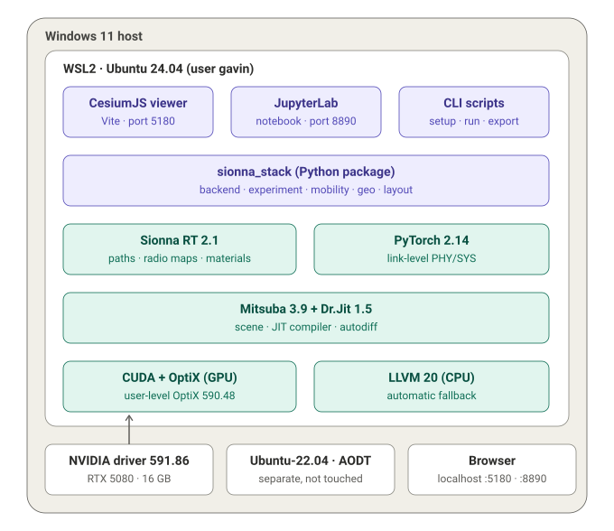

and then the path the data takes from the real map to your browser:

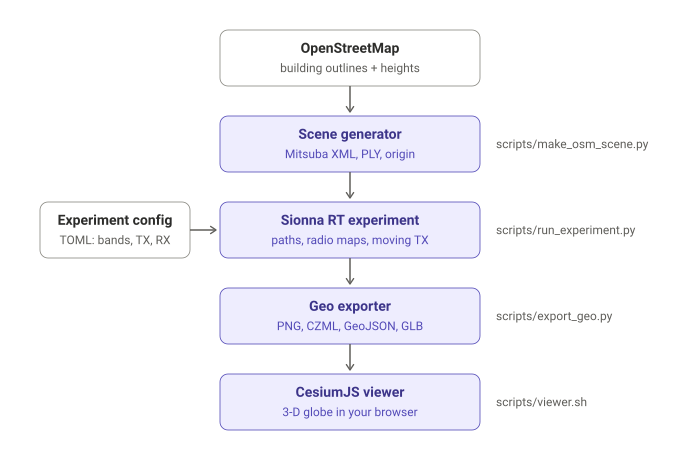

Why so many layers?

* **Why Linux inside Windows?** Sionna is made for Linux (Ubuntu 24.04 is its recommended system). WSL2 lets us
  run a real Ubuntu inside Windows without a second computer. It's kept separate from your other WSL system
  (the one used by NVIDIA AODT), so nothing interferes.
* **Why a GPU?** Tracing millions of rays is exactly what graphics cards are built for. The whole two-band
  experiment runs in about 20 seconds; most of that is drawing pictures.
* **Why is there a CPU fallback?** If the graphics card isn't available (for example after a driver update,
  see section 14), the stack automatically uses the processor instead. Slower, same physics.
* **Why "pinned versions"?** Every software version is written down in a lock file (`uv.lock`), so the setup
  can be rebuilt identically months from now. That's what "replicable" means here.

## 4. Getting in: opening Ubuntu and the project

Everything runs inside Ubuntu. Open a **PowerShell** window (or Windows Terminal) and type:

```bash
wsl -d Ubuntu-24.04
```

The prompt changes to something like `gavin@PC:~$`. You're now in Linux. Go to the project folder:

```bash
cd ~/projects/sionna-stack
```

(`~` means "my home folder", here `/home/gavin`.) To leave Ubuntu later, type `exit`.

**Seeing the files from Windows:** paste this into the File Explorer address bar:

```
\\wsl.localhost\Ubuntu-24.04\home\gavin\projects\sionna-stack
```

Or, from inside Ubuntu in the project folder, open Explorer right there with:

```bash
explorer.exe .
```

## 5. The commands you will use

Run these from inside the project folder (section 4).

### 5.1 `./setup.sh`: "Is everything installed and healthy?"

```bash
./setup.sh
```

It checks the system, makes sure the Python environment matches the lock file, checks the graphics driver, and
ends with a report like:

```
Active backend : CUDA/OptiX (GPU)
GPU / driver   : NVIDIA GeForce RTX 5080 / 591.86
```

`[ok]` lines are good. `[!!]` lines are warnings with an explanation. It's safe to run as often as you like.

### 5.2 `uv run verify.py`: "Does a tiny simulation work?"

```bash
uv run verify.py
```

A 2-second smoke test on a small street scene. It should end with `verify: OK`. `uv run` means "run this with the
project's own Python and its exact library versions".

To also check that the processor fallback works and gives the same answer as the graphics card:

```bash
uv run verify.py --all-backends
```

### 5.3 `uv run scripts/run_experiment.py …`: "Run the real experiment"

```bash
uv run scripts/run_experiment.py configs/munich_frequency.toml
```

About 20 seconds. It prints a table and saves everything into a new folder named with the date and time, for
example `outputs/munich_frequency/20260927-164221/`. Each run gets its own folder, so old results are never
overwritten.

### 5.4 `./scripts/jupyter.sh`: "Explore interactively"

```bash
./scripts/jupyter.sh
```

This starts **JupyterLab**, a notebook in your web browser that mixes explanations, code and pictures. Copy the
printed link (it looks like `http://127.0.0.1:8890/lab?token=…`) into your Windows browser. Open
`frequency_experiment.ipynb`, then choose **Run → Run All Cells**. Scroll to the end for a **3-D view you can
rotate** (left-drag = rotate, scroll = zoom, right-drag = move). When you're finished, go back to the terminal
and press **Ctrl+C** (twice if asked) to stop it.

### 5.5 `uv run scripts/export_geo.py …`: "Put the newest results on the map"

```bash
uv run scripts/export_geo.py outputs/sg_raffles_place/latest
```

Converts a run into files the globe viewer understands (only works for scenes with real map coordinates, like
Singapore; see section 9). `latest` always means "the newest run of this experiment".

### 5.6 `./scripts/viewer.sh`: "Open the 3-D globe"

```bash
./scripts/viewer.sh
```

Starts the viewer. Leave this window open and go to **http://localhost:5180** in your Windows browser. Stop it
with **Ctrl+C**. Section 11 explains the screen.

## 6. How the test is conducted, step by step

The experiment is a **controlled comparison**: we change *one* thing (the frequency) and keep *everything else*
identical, so any difference in the results must come from the frequency.

| Kept the same | Changed |
|---|---|
| The city model (Munich) | Frequency: 3.5 GHz, then 28 GHz |
| Transmitter position and power (44 dBm) | |
| Receiver positions | |
| Antennas (simple "isotropic" ones that send equally in every direction) | |
| Simulation settings (how many bounces, which effects) | |
| Colour scale of the maps | |

All of these settings live in one text file: `configs/munich_frequency.toml`. Open it with any text editor; it's
commented.

### Step 1: Load the city

We use **Munich**, a 3-D city model that ships with Sionna (about 1.5 km × 1.2 km of real Munich streets and
buildings). Every surface has a **material** (marble, concrete, brick, metal, wood). Materials matter because
they decide how much of the wave is reflected or absorbed, and that depends on frequency. Sionna uses official
material data from the ITU (the international telecom standards body, recommendation ITU-R P.2040).

### Step 2: Place the transmitter and receivers

* **TX** on a rooftop at 27 m height, sending 44 dBm.
* **rx_los**: 80 m away along an open square, clear line of sight.
* **rx_nlos**: about 100 m away, behind a building.
* **rx_nlos_far**: about 170 m away, deeper in the side streets.

These spots weren't guessed: a quick "can I see the transmitter from here?" ray test was run over the whole
area to pick one clearly visible and two clearly hidden positions. The experiment then *measures* again whether
each receiver really has line of sight, and reports it in the `los` column.

### Step 3: Set the frequency (3.5 GHz first)

This single setting changes the wavelength and, automatically, the electrical properties of every material.

### Step 4: Trace the paths to the three receivers

Sionna fires about a million rays from the transmitter and finds every route to each receiver with up to
**5 interactions** (bounces or bends). It includes line of sight, reflections, transmission through surfaces and
**diffraction**. For every path it records how strong it is, how long it takes, and where it bounced.

### Step 5: Compute the radio map

Separately, it fires **10 million rays** and records how much power lands on each 2 m × 2 m square of an
imaginary horizontal sheet at 1.5 m height, 500 m × 500 m around the transmitter. That's 62 500 squares.

### Step 6: Measure

For each receiver: number of paths, strongest path, total received power, delay spread. For the radio map: what
share of squares got usable signal (above −130 dB path gain), and the typical (median) signal level.

### Step 7: Draw pictures and save everything

Sionna's own pictures (2-D map, 3-D city with the map painted on, the ray paths), plus our comparison charts,
tables and raw data.

### Step 8: Repeat steps 3–7 at 28 GHz, then compare

Once both bands are done, the script draws side-by-side comparisons on the **same colour scale** and writes the
summary (`manifest.json`) recording exactly what was run, on which hardware, with which software versions.

```
 config file ──► load Munich ──► place TX + 3 RX ──┐
                                                   ▼
             ┌──────────── for each band (3.5 GHz, 28 GHz) ────────────┐
             │ set frequency → trace paths → radio map → measure → draw │
             └──────────────────────────────────────────────────────────┘
                                                   ▼
                      compare bands (same scale) ──► save tables + summary
```

## 7. Reading the results, picture by picture

Results are in `outputs/munich_frequency/<date-time>/`. The pictures below come from the first real run.

### 7.1 `comparison_radio_maps.png`: the headline picture

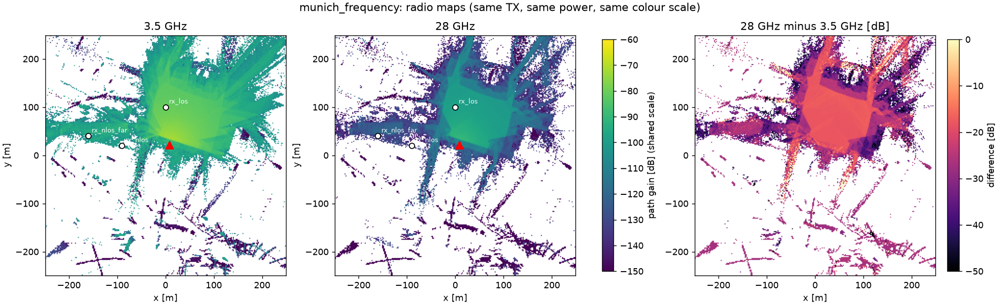

A bird's-eye view, 500 m × 500 m. **Red triangle** = transmitter; **white dots** = receivers.

* **Colour** = path gain. Yellow/green = strong, blue/purple = weak, **white = no ray arrived** (inside a
  building, or in deep shadow).
* **Left (3.5 GHz):** the open square around the transmitter is bright, and signal spreads well into the side
  streets (the green "fingers" to the west).
* **Middle (28 GHz):** same shape, but everything is darker, and the side streets fade to blue/purple.
* **Right (difference):** how many dB weaker 28 GHz is, square by square. Orange ≈ 18 dB weaker (the open
  square), purple/black ≈ 30–50 dB weaker (behind buildings).

Because all maps use **the same colour scale**, you can compare colours directly.

### 7.2 `band_*/scene_radio_map.png`: the map painted onto the 3-D city

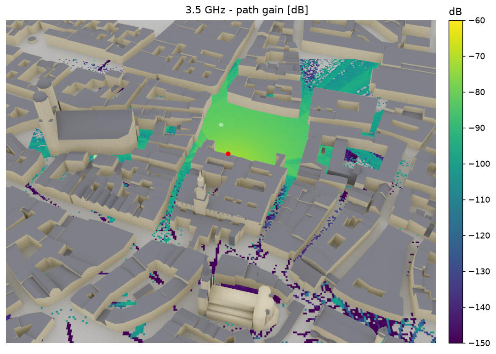

The same radio map (3.5 GHz here) drawn onto Sionna's 3-D model of Munich. The red dot is the transmitter. This
makes it easy to see *which buildings* cast radio "shadows". Compare with `img/scene_radio_map_28GHz.png`.

### 7.3 `band_*/radio_map_sionna.png`: Sionna's own 2-D map


The same information as the left panel of 7.1, drawn by Sionna's built-in `show()` function. The axes are grid
cell numbers instead of metres. Useful as a cross-check that our own chart matches Sionna's.

### 7.4 `band_*/scene_paths.png`: the actual paths


Each line is one path from the transmitter (red dot) to a receiver (green dots). The receiver in the open square
gets **hundreds** of paths (bounces off all the surrounding façades). The hidden receivers get only a handful,
bending over roof edges or around corners.

### 7.5 `power_delay_profiles.png`: when each path arrives


One panel per receiver. Each stick is one path. **Left–right** = arrival time (nanoseconds after
transmission), **height** = strength. Blue circles = 3.5 GHz, orange squares = 28 GHz.

* In **rx_los**, the first stick (at about 280 ns) is the direct path; at 28 GHz it's about 18 dB lower.
* In **rx_nlos_far**, 3.5 GHz has a strong early path (at about 645 ns) that **disappears** at 28 GHz. That one
  missing path is why the delay spread drops so much there.

### 7.6 `path_gain_cdf.png`: how good is coverage overall?


Read it like this: pick a signal level on the bottom axis, go up to a curve, and read on the left what fraction of
the (reached) map is **at or below** that level. The dashed line is the −130 dB threshold. At 3.5 GHz only about
10 % of reached squares are worse than −130 dB; at 28 GHz about 40 % are. **The further right a curve sits, the
better the coverage.**

### 7.7 `metrics.md` / `metrics.csv`: the numbers

`metrics.csv` opens in Excel. The main columns:

| column | meaning |
|---|---|
| `band_ghz` | frequency |
| `rx` / `expected` / `los` | receiver name / what we intended / what was measured (True = line of sight) |
| `num_paths` | how many routes the signal found |
| `strongest_path_gain_db` | the single best path |
| `total_path_gain_db` | all paths' power added together |
| `rx_power_dbm` | what the phone would receive (44 dBm + total path gain) |
| `rms_delay_spread_ns` | how smeared out in time the arrivals are |
| `num_paths_with_diffraction` | how many paths bent around at least one edge |

`radio_map_stats.csv` has one row per band: share of the map reached by any ray, share above −130 dB, and the
median signal.

### 7.8 `manifest.json`: the run's "lab notebook"

A text file recording *exactly* what was done: the full configuration, the graphics card and driver, all software
versions, timings, and any warnings. If someone asks "how did you get this number?", the answer is in here.

## 8. What the results tell us

| receiver | 3.5 GHz | 28 GHz | 28 GHz is weaker by |
|---|---|---|---|
| rx_los (line of sight) | −81 dB | −99 dB | **18 dB** |
| rx_nlos (behind a building) | −111 dB | −144 dB | **33 dB** |
| rx_nlos_far (deeper) | −106 dB | −145 dB | **39 dB** |
| share of map above −130 dB | 32 % | 20 % | |

**Finding 1: in the open, 28 GHz loses a predictable 18 dB.** Physics predicts that, with simple antennas, the
received power falls with the square of the frequency ratio: (28 / 3.5)² = 64 times, which is 18 dB. The
simulation gives 17.5 dB. That's a good sign it behaves correctly. (Real 28 GHz systems win this back with
**antenna arrays** that focus the beam; that's a natural next experiment.)

**Finding 2: behind buildings, 28 GHz loses much more (33–39 dB).** On top of the 18 dB, the signal that bends
around corners (diffraction) is much weaker at shorter wavelengths. So streets that are "OK" at 3.5 GHz
become "no service" at 28 GHz.

**Finding 3: fewer strong echoes at 28 GHz.** At the far receiver, a strong early path vanishes at 28 GHz, and
the delay spread drops from about 119 ns to about 6 ns. At mmWave, the channel often depends on just a few
paths, which makes it fragile (one blocked path can drop the link).

**Bottom line:** 3.5 GHz covers a neighbourhood well from one rooftop. 28 GHz needs line of sight or many more
sites (or beamforming) to cover the same streets.

## 9. Singapore: a real place on the map

The Munich model is great for learning, but it has no map coordinates: nobody recorded where its (0, 0) point
is on Earth, so it can't be placed on a globe. For Singapore we built the city model ourselves from
**OpenStreetMap** (the free, community-made world map), so we know exactly where every point is.

**How the Singapore model was made** (one command, see the [rebuild manual](REBUILD_FROM_ZERO.md) §7):

1. Download the outline and height of every building in a 600 m × 600 m square around **Raffles Place**
   (latitude 1.2840° N, longitude 103.8514° E). A copy of that download is kept in the project, so the model
   can be rebuilt identically later.
2. Turn every outline into 3-D blocks ("extrude" them) as tall as the recorded height. Buildings mapped in
   pieces (a wide base with a slimmer tower, stepped tops) are built from those pieces: 154 simple outlines plus
   120 pieces, 3–285 m tall. Where the map records the material (glass, stone, metal, concrete), it's used;
   otherwise concrete is assumed.
3. Save it in the simulator's format, together with the exact map position of its centre point.


*The generated Raffles Place model, rendered by Sionna. Colours show the materials: blue = glass, beige = stone,
dark grey = metal, light grey = concrete.*

**The test** is the same as in Munich (section 6): same transmitter and power, three receivers (one in view, two
hidden) chosen by the same rules (now automatic), and several frequencies. Here the transmitter is a **small
cell at 12 m** in the Raffles Place plaza with a simple "ball" antenna; section 12 adds realistic antennas.

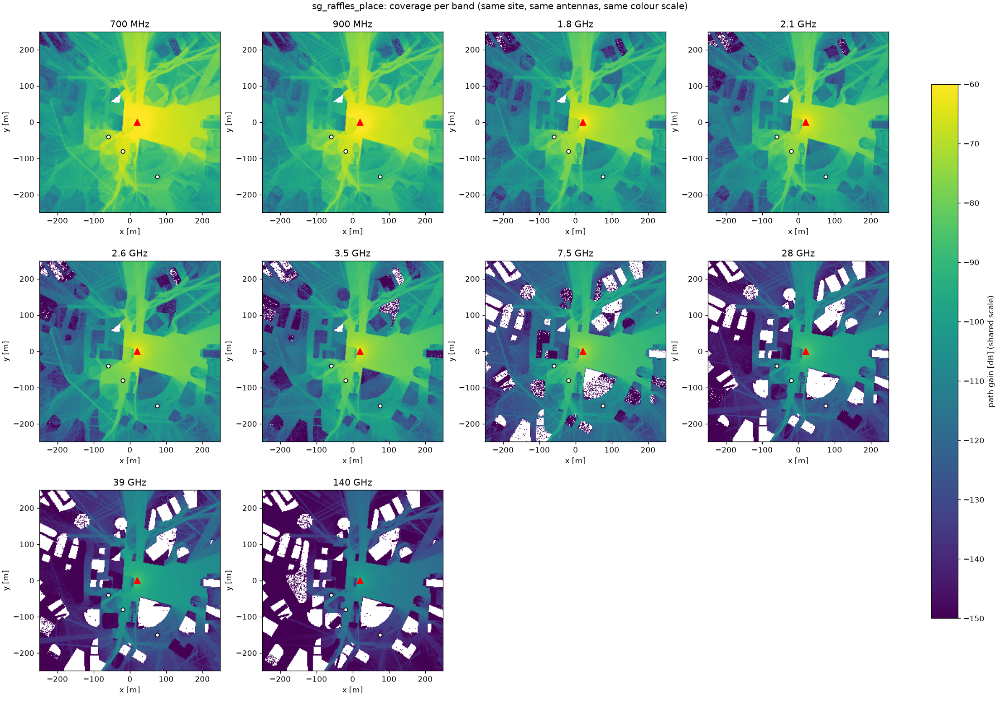

*Signal strength over the area for all 10 bands, same colour scale (from the reference run).*

**Results in plain words (3.5 GHz vs 28 GHz):**

| receiver | 3.5 GHz | 28 GHz | 28 GHz is weaker by |
|---|---|---|---|
| rx_los (in view, 90 m) | −81 dB | −101 dB | 20 dB |
| rx_nlos (hidden, 90 m) | −95 dB | −117 dB | 23 dB |
| rx_nlos_far (hidden, 160 m) | −105 dB | −127 dB | 22 dB |

Surprise compared with Munich: behind buildings, 28 GHz is only ~22 dB weaker instead of 33–39 dB. Why? In
Munich the signal reaches hidden streets mostly by **bending around roof edges** (diffraction), which gets much
weaker at high frequency. Between Singapore's tall towers the signal reaches hidden spots mostly by **bouncing
off the tower walls** (reflection), like light in a corridor of mirrors, and reflections don't get much weaker
at higher frequency. **The type of city matters as much as the frequency.** That's why it's worth simulating
the real place.

## 10. The moving transmitter

"Can we move the transmitter and watch what happens?" Yes. The simulator computes one **snapshot** at a time
(where are all the paths *right now*?). To show movement, we move the transmitter a little, compute another
snapshot, and repeat, like the frames of a film.

**The test:** the same small cell is mounted on a vehicle (3 m high) and drives **300 m along the straight
street through Raffles Place at 10 m/s (36 km/h)**. That takes 30 seconds, and we compute **60 snapshots**
(every half second, every 5 m), for all 10 bands. The three receivers stay where they are.

At each snapshot we record the paths to each receiver, a full radio map, and the **Doppler shift**: the tiny
change in frequency caused by movement (the same effect that makes a passing ambulance siren sound higher, then
lower).

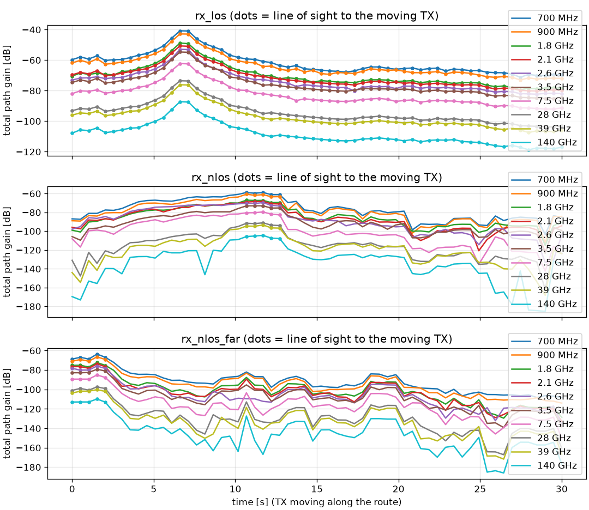

**How to read this chart:** one panel per receiver; the line shows how strong the signal is as the vehicle drives
(time on the bottom). One line per band, from 700 MHz (top) to 140 GHz (bottom). Dots mark moments when the
receiver can **see** the vehicle.

* **rx_los** can see the street all the time. The signal peaks at about 7 s, when the vehicle passes closest.
* **rx_nlos** only sees the vehicle for a moment (around 11–13 s), when it crosses the end of its street. The
  signal jumps by about 30 dB and drops again. At 28 GHz there are deep drops (down to −160 dB) when only weak
  bounced paths remain.
* **rx_nlos_far** stands on the same street where the route starts: in view for the first ~2 seconds, then the
  vehicle turns up the street and the signal drops by 20–40 dB (more at higher bands).
* **Doppler:** at most **117 Hz at 3.5 GHz and 934 Hz at 28 GHz**, exactly what physics predicts for 10 m/s
  (the shift grows with frequency). This is a nice check that the simulation is right.

The animation `mobility/mobility_radio_maps.gif` in the run folder shows the whole radio map changing as the
vehicle drives, for all 10 bands. A smaller version with 700 MHz, 3.5 GHz and 28 GHz is below.


In the viewer (Moving TX tab, 3.5 GHz) the same drive looks like this. Watch the paths to the three receivers
change as buildings come between them and the transmitter:

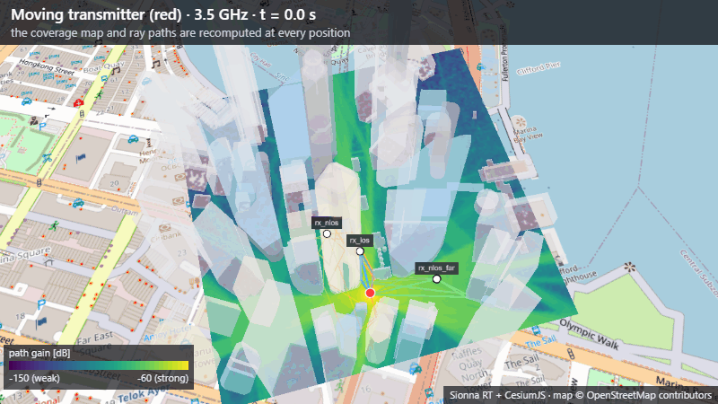

## 11. The 3-D globe viewer

The viewer puts everything on a real 3-D world map in your browser, so you can fly around Raffles Place and see
where the signal goes. Start it with `./scripts/viewer.sh` and open **http://localhost:5180**
(section 5.5–5.6: run → export → view).


Switching the band buttons (reference transmitter, same colour scale for all 10 frequencies):


(These animations are recorded from the viewer itself; to make them again after a new run, see Developer Guide
§24.)

**What you see on the map** (also explained in the viewer under "What am I looking at?"):

| on screen | meaning |
|---|---|
| red dot | the transmitter. In Moving TX mode it drives along the street and leaves a red trail. |
| white circles with labels | the three receivers (phones at 1.5 m) |
| coloured ground ("carpet") | signal strength at 1.5 m height, using the legend: yellow = strong (about −60 to −85 dB), green = medium, blue/purple = weak (−130 to −150 dB), no colour = no signal reached that spot (inside a building or deep shadow) |
| lines | the routes the signal takes from the transmitter to a receiver. **Colour = which receiver** (blue `rx_los`, orange `rx_nlos`, green `rx_nlos_far`, same as the chart). **Solid and thick = strong path; faint and thin = weak path.** A straight line is line of sight; a kinked line bounced off a wall or bent around an edge. |
| grey blocks | the buildings the simulation used. They're half see-through by default; change this with "building opacity". |

If the view is cluttered, press **Top view**: from straight above, the coloured ground reads like a coverage map.

**The panel on the left** (Cesium's pop-ups open on the right). The top part is always visible; the rest is in
four tabs. **?** opens the "What am I looking at?" card beside the panel, **‹** hides the panel (the **›** button
brings it back).

| where | control | what it does |
|---|---|---|
| top | Simulation run | pick which exported run to show (newest first). New runs appear after you export them and reload the page. Hover the grey description for the full text. |
| top | **Fixed TX** / **Moving TX** | fixed transmitters, or the driving vehicle (section 10; only the Raffles reference run has one, hover the button for why it's greyed out) |
| top | Band buttons + colour legend | switch frequency; the colour scale stays the same, so colours are comparable |
| **Signal** tab | Coverage map on the ground | the coloured "carpet" of signal strength on the streets; on/off and transparency |
| Signal tab | Total path gain vs time | (Moving TX) the chart from section 10, with a line at the current moment |
| Signal tab | Link metrics | (Fixed TX) the numbers table for the selected band |
| **3-D** tab | dark view, coverage shells, signal at height | (Fixed TX, runs with a 3-D volume) see section 12.6; greyed out otherwise |
| **Receivers** tab | Ray paths per receiver | show/hide the lines to each receiver. Line colour = which receiver (same as the chart); solid and thick = strong path, faint and thin = weak path. |
| **Scene** tab | Camera | **Top view** (straight down, like a map) or **3D view** |
| Scene tab | Buildings | show/hide the simulation's buildings, their transparency, and the material colour key |
| Scene tab | Base map | OpenStreetMap (needs internet, no account), Natural Earth (works offline, very coarse), Cesium ion (real terrain and satellite images, needs a free Cesium account and token; see the rebuild manual §3.9) |
| Scene tab | footer | backend, versions, accuracy notes, warnings and data credits |

The Cesium logo is hidden. The map-data credit stays visible at the bottom right, as the OpenStreetMap licence
requires; with a Cesium ion token the ion logo is shown, as ion's terms require.

**In the map:** drag to rotate, scroll to zoom, right-drag to tilt. **Click** a receiver marker to see its numbers
(line of sight, number of paths, signal, delay spread for each band), or click a path line to see that path's
strength, delay and how it bounced.

**Moving TX mode:** only the reference run (`sg_raffles_place`) contains a moving-transmitter simulation; for the
macro and small-cell runs the **Moving TX** tab is greyed out and there is no timeline. In the reference run,
choose **Moving TX**, then press the **play ▶** button at the bottom-left (the round clock) or drag the
**timeline** at the bottom. The red dot drives along the street, leaving a trail; the paths and the radio map change with it,
and the chart cursor follows.

**Is it in the right place?** Yes. In Top view, the signal carpet fills exactly the streets of the OpenStreetMap
background, and the buildings sit exactly on the map's building outlines. The numbers at the bottom of the
panel record which computer/software produced the run and the known accuracy limits (map outlines are
typically accurate to a few metres; heights are approximate).

## 12. Realistic transmitters, 10 frequencies, and how accurate it is

Sections 6–11 used a deliberately simple transmitter (one "ball" antenna that sends equally in all directions)
and a simple city (every building one concrete block). That's good for understanding, but real networks look
different. This section describes the upgraded, more realistic simulation.

### 12.1 What was made more realistic

* **Buildings:** for 85 building volumes the map data records the material (among them 23 glass, 22 stone,
  12 metal), and many buildings are mapped in pieces (a wide base with a slimmer tower on top, stepped roofs). The model now uses all of that.
  Buildings without a recorded material are assumed concrete.
* **Rough walls:** real walls aren't perfect mirrors. Part of the signal hitting them is scattered in all
  directions ("diffuse scattering"). This is now simulated, with a roughness value per material.
* **Enough rays:** the simulation fires rays like a sprinkler. Too few rays give a speckled, unreliable map. A
  test ("convergence study") increased the number until the results stopped changing: **1 billion rays and up to
  10 bounces per map** (about 5 seconds each on the graphics card). With the old setting (10 million rays), the
  covered area was underestimated by up to 12 percentage points once rough walls were included.
* **Frequencies:** 10 bands from 700 MHz to 140 GHz (see the table below).
* **Transmitters with real antennas, power and channel widths**, so the results include how fast a phone could
  download (see 12.3).

### 12.2 A few more ideas (in plain words)

| term | meaning |
|---|---|
| **sector** | a base station usually has 3 antenna panels, each covering a 120° slice ("sector") around it |
| **antenna gain (dBi)** | how much a directional antenna concentrates power in its main direction, compared with a "ball" antenna. 14 dBi ≈ 25× stronger in the main direction (and weaker elsewhere) |
| **downtilt** | antennas on a roof point slightly downwards (here 10°) so the energy lands in the streets, not over the horizon |
| **beam / beamforming** | a grid of many small antennas (e.g. 8 × 8) can focus energy into a narrow "beam" and point it electronically. 5G mmWave cells sweep beams and serve each phone with its best one |
| **EIRP** | transmit power + antenna gain: the power a "ball" antenna would need for the same signal in the main direction. Typical mmWave small cell: ~56 dBm |
| **bandwidth** | how wide the radio channel is (10 MHz at 700 MHz … 400 MHz at 28 GHz). Wider = more data, but also more noise |
| **noise** | background radio noise the phone always receives; grows with bandwidth |
| **SNR** | signal-to-noise ratio in dB: how far the signal is above the noise. Below 0 dB a link basically doesn't work; above ~20 dB it's excellent |
| **data rate (Shannon bound)** | the theoretical maximum Mbit/s for a given bandwidth and SNR. Real 5G gets roughly half to three quarters of it, and less when many users share a cell |

### 12.3 The three experiments

| experiment | transmitter | bands | question |
|---|---|---|---|
| **reference** (`sg_raffles_place`) | "ball" antenna at 12 m in the plaza, 44 dBm, plus the driving vehicle | all 10: 700 MHz, 900 MHz, 1.8, 2.1, 2.6, 3.5, 7.5, 28, 39, 140 GHz | pure physics: what does frequency alone do? |
| **rooftop macro** (`sg_macro`) | 3 sectors on a 43 m roof (antennas at 47 m), 10° downtilt, standard 3GPP panels (~14 dBi), 46 dBm (40 W) per sector | 700 MHz – 7.5 GHz (the bands such sites carry) | what would a typical city base station deliver? |
| **mmWave small cell** (`sg_smallcell_mmwave`) | lamppost at 6 m, 2 panels along the street, each 8 × 8 antennas sweeping 18 beams, 30 dBm per panel (~56 dBm EIRP) | 28, 39 GHz (5G mmWave) and 140 GHz (6G candidate) | what would a street-level mmWave cell deliver? |

The bands are the ones used in Singapore (700/900/1800 MHz, 2.1, 2.6, 3.5 GHz, mmWave, 39 GHz in trials) plus two
6G candidates. I chose the transmitter values as typical for such sites; they're not a specific operator's
equipment.

### 12.4 Results

The rooftop macro in the viewer, band by band (received power in dBm, same colour scale):


**Rooftop macro** (share of the outdoor area within 250 m where the phone has usable signal, SNR above 0 dB):

| band | 700 MHz | 900 MHz | 1.8 GHz | 2.1 GHz | 2.6 GHz | 3.5 GHz | 7.5 GHz |
|---|---|---|---|---|---|---|---|
| covered | 100 % | 100 % | 99.9 % | 99.9 % | 99.8 % | 99.5 % | 96.4 % |
| typical signal (median) | −32 dBm | −34 dBm | −41 dBm | −42 dBm | −45 dBm | −48 dBm | −56 dBm |
| data-rate bound at `rx_los` | 262 Mbit/s | 255 | 448 | 435 | 421 | 1,822 | 2,901 |

**mmWave small cell** (one lamppost):

| band | 28 GHz | 39 GHz | 140 GHz |
|---|---|---|---|
| covered (SNR > 0 dB) | 46 % | 42 % | 15 % |
| data-rate bound at `rx_los` (in view, 90 m) | 2,649 Mbit/s | 2,208 | 1,444 |
| data-rate bound at `rx_nlos_far` (hidden, 160 m) | 485 Mbit/s | 299 | 31 |

**What this tells you:**
* **Lower bands reach everywhere, higher bands carry more data.** The macro covers the whole area at every band up
  to 3.5 GHz. But 3.5 GHz, with its 100 MHz channel, can deliver about 7× more data than 700 MHz (10 MHz channel)
  where the signal is good. That's why operators use both: low bands for coverage, mid bands for capacity.
* **7.5 GHz (6G "FR3") behaves much like 3.5 GHz, just a bit weaker:** 96 % coverage from a rooftop, with twice
  the channel width. That's why it's a leading 6G candidate.
* **mmWave needs line of sight or very close cells.** One lamppost covers under half of the nearby streets at
  28 GHz, and 140 GHz covers about a sixth. Where it does reach, it's extremely fast.
* The **frequency-sweep chart** (`band_summary.png` in each run folder) shows all of this in one picture: signal
  and SNR fall with frequency, but the data rate rises because of the wider channels, until coverage runs out.


### 12.5 How accurate is it?

Nothing here has been compared with real measurements yet, so the honest answer comes in three parts:

1. **The simulation itself is converged:** repeating it with 3× more rays changes the maps by 0.2–0.3 dB on
   average. The numbers aren't random noise.
2. **The uncertain assumptions were tested** by re-running with them changed (a "sensitivity study"):

   | if we assume … | effect on the signal |
   |---|---|
   | buildings without a recorded material are **glass** instead of concrete | about **+6 dB** on average below 6 GHz (thin glass lets low frequencies through buildings); small at mmWave |
   | walls are **perfectly smooth** | average unchanged; shadowed-area coverage −3 to −4 percentage points at 3.5–28 GHz |
   | walls are **twice as rough** | average unchanged; mmWave coverage up to +7 percentage points |

   So the **biggest uncertainty is what the untagged buildings are made of**. Many real glass façades have metal
   coatings that block signals, so reality probably lies between "glass" and "concrete".
3. **What's still missing:** trees, cars, people, detailed façades (windows, balconies), terrain, and other
   base stations (interference). These usually cost a few more dB in reality.

**Rule of thumb:** trust the comparisons (which band covers more, which site is better, how the signal changes
along a street) more than individual absolute numbers. Individual spots may be off by several dB. **To make the
absolute numbers trustworthy:** take 10–20 signal readings with a phone field-test app at known places near a
real site. The simulation can then be tuned (calibrated) to match them.

### 12.6 The signal in 3-D (coverage shells and the height slider)

The coloured ground shows the signal at 1.5 m only. Radio waves fill the whole space, so the simulation also
measures the signal on **31 invisible sheets stacked from 1.5 m up to 150 m** (every 5 m), which gives a 3-D grid
of signal strength over the whole area (about 480,000 small boxes of 4 m × 4 m × 5 m).

**What it looks like:** not a neat dome. Around the transmitter there's a bubble of strong signal, which
stretches far along open streets and over rooftops, is carved away in the "radio shadow" behind every tower, and
for a rooftop macro forms three tilted lobes (one per sector). At higher frequencies everything shrinks.

**Vertical cut** (`volume_slices.png` in each run folder): the signal on a vertical wall through the
transmitter, from ground to 150 m. Grey = inside a building. Reference transmitter (path gain, all 10 bands):

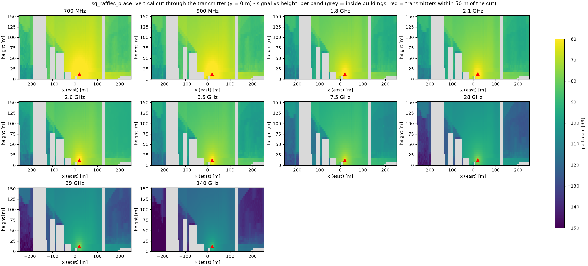

Read it like a side view: the yellow "bubble" around the red triangle is the strong signal, the darker wedges
behind the grey towers are radio shadows, and the whole picture gets darker (weaker) band by band.

**Coverage shells** (`volume_shells_3d.png`, and interactively in the viewer): a shell is a see-through 3-D
surface; **inside it the signal is stronger than the shell's level**. Here the −90 dB shell for every band
(same transmitter, same threshold):

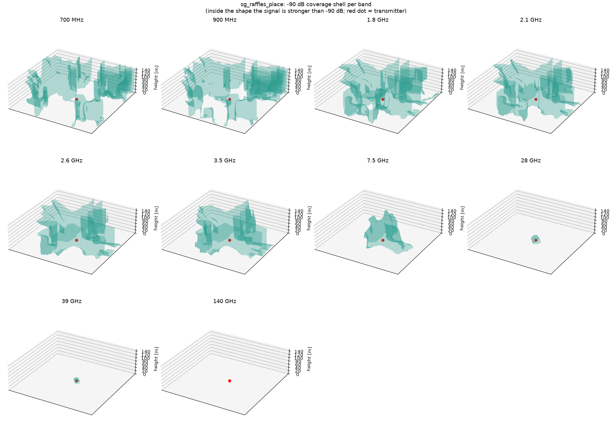

From 700 MHz to 3.5 GHz the −90 dB region fills most of the modelled block up to 150 m (open where it runs past
the box edge), with gaps in the shadow of the towers. At 7.5 GHz it has shrunk to a lumpy dome around the
transmitter, at 28/39 GHz to a small bubble a few tens of metres across, and at 140 GHz the signal never gets
that strong at all (no shell). Same place, same transmitter, only the frequency changes.

The same shell in the viewer, turning around the site while the band changes:


The realistic 3-sector macro (received power in dBm) shows the same trend at −45 dBm:

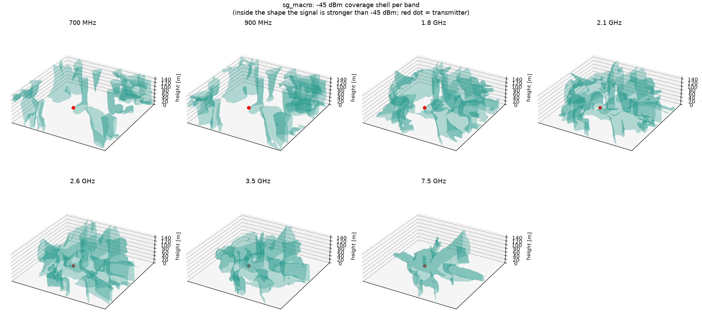

And the 6 m street-level mmWave small cell at −85 dBm: at 28/39 GHz the beams light up the street canyons and
climb the facades facing the lamp-post, at 140 GHz only a flat star along the nearest streets is left:

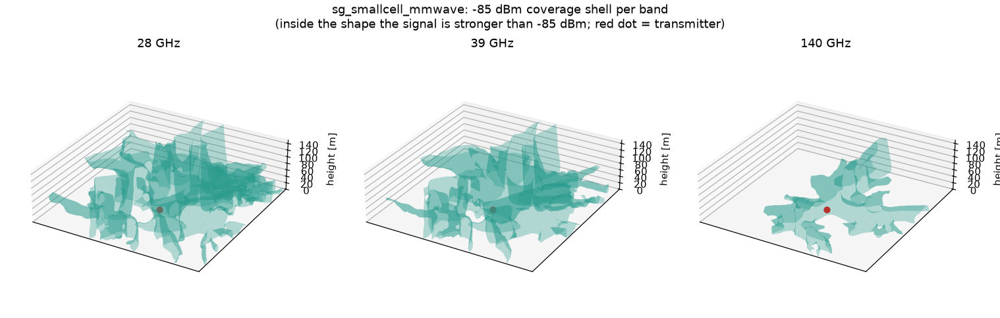

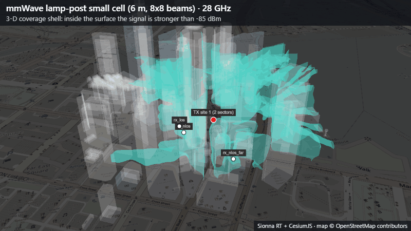

**Choosing shell levels:** a shell is only informative when its level lies inside the range of values in the
volume. If a level is weaker than almost everything (e.g. −80 dBm for the 46 dBm macro), the "shell" only traces
the few weak pockets behind buildings. `uv run python tools/volume_stats.py outputs/<run>/latest` prints the
spread of values per band; pick levels between the 5 % and 95 % columns, put them in `[volume] shell_levels`,
then redraw and re-export in seconds (no recomputation):

```bash
uv run scripts/run_volume.py configs/sg_macro.toml outputs/sg_macro/latest --figures-only
uv run scripts/export_geo.py outputs/sg_macro/latest
```

**In the viewer** (the **3-D** tab of the panel, Fixed TX mode):
* **dark view:** the clearest way to look at the shells. The street map turns dark grey, buildings become faint
  grey outlines (no material colours), the ground map and ray paths are hidden, and only the signal is coloured
  (bright teal shells, plus the height map if you switch it on). The camera moves to a lower, closer angle. It
  stays on while you switch bands; untick it to get the normal view back. Tip: add `&dark=1` to the address to
  open the viewer straight in this view.
* **shell checkboxes:** switch each level on or off (e.g. −100 / −90 / −80 dB for the reference run, −60 / −45 / −30 dBm for the macro). The outer (weaker) shell is
  the edge of usable signal, the inner ones the strong core. Where a shell reaches the edge of the computed box
  (250 m from the centre, 150 m high), it's left open: the signal continues beyond the modelled area.
* **signal at height:** shows the coloured map floating at the height you choose with the slider (1.5–150 m):
  e.g. "is there signal on the 20th floor?" (≈ 60 m) or "at drone height?".
* **band buttons:** switch frequency and watch the 3-D shape grow or shrink.
* Tip: use **3D view**, lower the **building opacity**, and switch the ground radio map off for a clear view.

The height slider moved from 1.5 m to 150 m (3.5 GHz). Near the ground there's a bright spot around the
transmitter and sharp radio shadows behind the towers; higher up, above most roofs, the signal is much more even
across the whole area. The purple patches that remain up there are inside the tall towers:

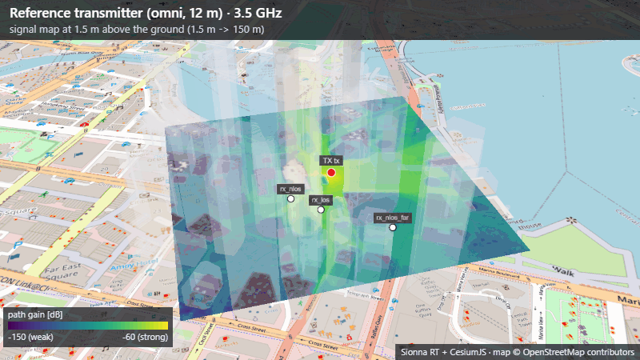

Inside buildings the shells use the simulated signal that passes through walls: at low frequencies shells go
through buildings (signal really penetrates), at mmWave they wrap around them.

#### Why is there sometimes nothing around the transmitter, only shapes far away?

A shell is **only the boundary surface** where the signal equals its level. Inside it the signal is stronger,
outside weaker, but the inside itself is empty (see-through). So what you see depends on how much of the air is
stronger than the level:

| share of the air inside the shell | what you see | how to read it |
|---|---|---|
| **almost all** (more than ~85 %) | nothing around the transmitters; scattered shapes far away and behind towers | the level is exceeded almost everywhere. The shapes wrap the few **weaker** pockets. Empty space = strong signal |
| **some** (~15–85 %) | a large, lumpy dome with holes | the dome is the **edge of coverage** at that level: stronger on the transmitter side, weaker beyond |
| **little** (less than ~15 %) | small bubbles right around the transmitters | only the air close to the antennas is this strong |
| **none** | nothing at all | no place reaches that level at this band |

Example from your viewer: the Downtown Core at **700 MHz**, shell **−45 dBm**. **99 %** of the outdoor air is stronger
than −45 dBm, so there is no surface near any of the 9 sites; the surfaces you see are the remaining 1 %, typically
**414 m** from the nearest site (the stronger air is typically 277 m from one). Switch to **3.5 GHz** and the same
level encloses only 72 % of the air: now the surface appears everywhere between the sites. At −35 dBm, 3.5 GHz
gives only 11 %: bubbles around each site.

**In the viewer** the share is written next to each shell (e.g. "(99 % of the air inside)"). Hover a shell for
the explanation that fits the current band, and the note below the shells explains the ones that are ticked.

The same on a vertical cut through the area: each coloured line is where a shell crosses the cut. For the
Downtown Core, the red −45 dBm line barely appears at 700 MHz (99 % is stronger), runs through the western CBD at
3.5 GHz (72 %), and the white −25 dBm line shrinks from large regions (30 %) to rings around the antennas (1 %):

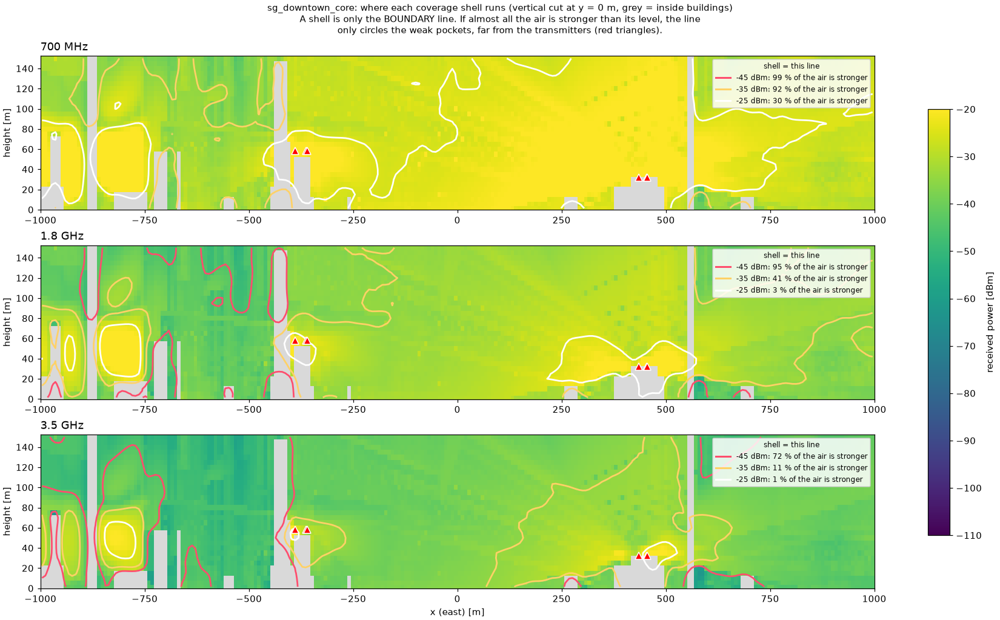

The reference transmitter in Raffles Place shows the whole progression over 10 bands: the red −100 dB line only
circles weak pockets behind buildings at 700 MHz (92 % inside), becomes the coverage edge at 2–7 GHz, and shrinks
to a ring around the antenna at 140 GHz (under 1 %):

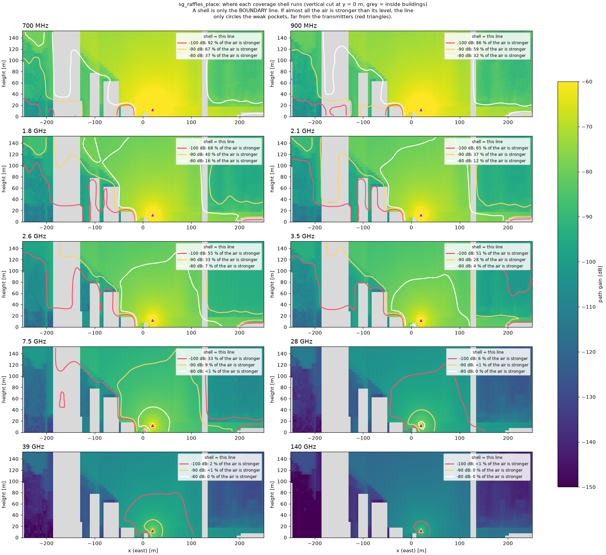

Share of the outdoor air inside each shell, for every run in the viewer:

| run (unit) | band | lowest level | middle level | highest level |
|---|---|---|---|---|
| Raffles reference (path gain dB: −100 / −90 / −80) | 700 MHz | 92 % | 67 % | 37 % |
| | 3.5 GHz | 51 % | 28 % | 4 % |
| | 28 GHz | 6 % | <1 % | 0 % |
| | 140 GHz | <1 % | 0 % | 0 % |
| Rooftop macro (dBm: −60 / −45 / −30) | 700 MHz | >99 % | 88 % | 30 % |
| | 3.5 GHz | 83 % | 29 % | 5 % |
| | 7.5 GHz | 53 % | 14 % | 1 % |
| mmWave small cell (dBm: −100 / −85 / −70) | 28 GHz | 86 % | 45 % | 10 % |
| | 39 GHz | 79 % | 35 % | 7 % |
| | 140 GHz | 48 % | 11 % | 1 % |
| Downtown Core network (dBm: −45 / −35 / −25) | 700 MHz | 99 % | 92 % | 30 % |
| | 1.8 GHz | 95 % | 41 % | 3 % |
| | 3.5 GHz | 72 % | 11 % | 1 % |

How to use this: to see "how far does the coverage reach", pick the level whose share is in the middle (roughly
20–80 %) at the band you're looking at; its shell is then the edge of coverage. A level near 100 % shows you the
**weak spots** instead, which is useful too (where would a phone struggle?), as long as you remember that the
empty space around the antennas means strong signal, not no signal. The same figure for the other runs:
[rooftop macro](img/sg_macro_volume_shell_levels.png),
[mmWave small cell](img/sg_smallcell_volume_shell_levels.png).

### 12.7 What the building material does (close-up)

In the city every spot gets signal from many buildings at once, so one material's effect is almost impossible to
pick out on the maps. Two close-ups make it visible.

**1. The material lab: one wall, one material at a time.** A single wall, 24 m wide and 15 m high, stands 10 m
from a transmitter (red dot). The simulation runs once with no wall and once per material (the same six materials,
thicknesses and roughness as the Singapore buildings), and the pictures show **what the wall changed** compared
with no wall: **blue = signal the wall took away** (the shadow behind it), **red = signal it added** (its
reflection, in front). Seen from above; the wall is the black line.

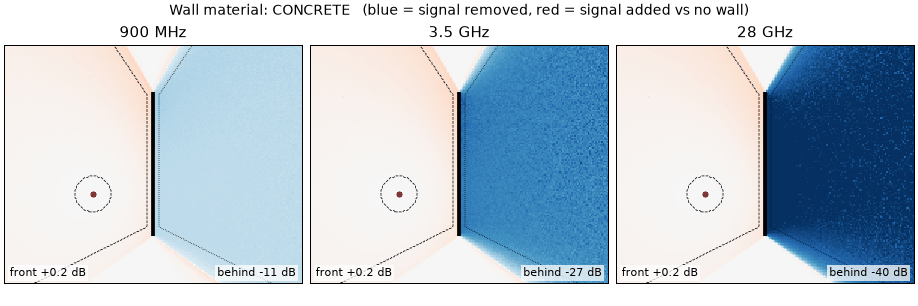

All materials and bands in one picture (dotted outline = the wall's shadow zone, dashed = where its reflection
lands):

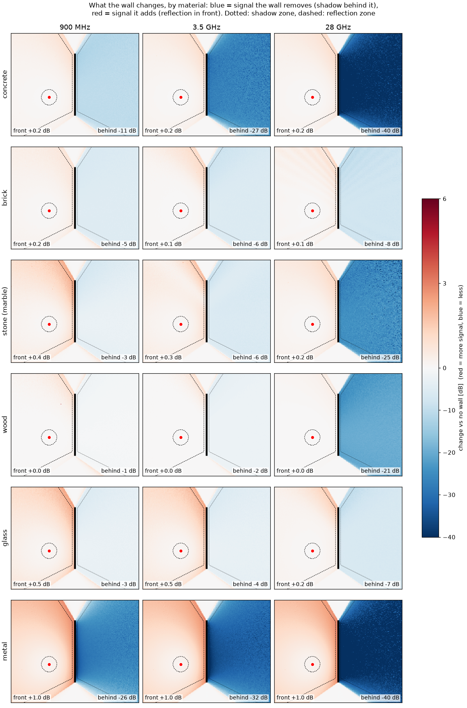

The same along one line straight through the transmitter and the wall. The drop at the wall is what each
material lets through:

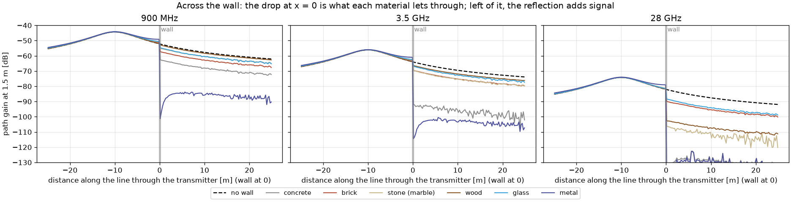

Median change behind the wall (in its shadow) and in front of it (where its reflection lands):

| material | 900 MHz: behind / in front | 3.5 GHz: behind / in front | 28 GHz: behind / in front |
|---|---|---|---|
| concrete (30 cm) | −10.6 dB / +0.2 dB* | −26.6 dB / +0.2 dB | −39.8 dB / +0.2 dB |
| brick (20 cm) | −5.3 dB / +0.2 dB* | −5.8 dB / +0.1 dB | −8.0 dB / +0.1 dB |
| stone (marble, 30 cm) | −3.3 dB / +0.4 dB* | −6.0 dB / +0.3 dB | −24.8 dB / +0.2 dB |
| wood (10 cm) | −0.7 dB / +0.0 dB | −2.4 dB / +0.0 dB | −20.5 dB / +0.0 dB |
| glass (double glazing, 2.4 cm) | −3.1 dB / +0.5 dB | −3.5 dB / +0.5 dB | −6.6 dB / +0.2 dB |
| metal | −25.9 dB / +1.0 dB* | −31.7 dB / +1.0 dB | −40.1 dB / +1.0 dB |

\* below 1 GHz there is no ITU data for these materials; the values are extrapolated.

How to read it:
* **Behind the wall, the material is everything.** Glass and brick let most of the signal through at every band;
  wood and stone are almost transparent at low frequencies but block a lot at 28 GHz; 30 cm of concrete loses
  about 11 dB at 900 MHz, 27 dB at 3.5 GHz and 40 dB at 28 GHz.
* **Metal lets nothing through.** The −26 to −40 dB behind a metal wall is signal that **bends around the wall's
  edges** (diffraction), not through it. That is also the floor for concrete at 28 GHz (−40 dB, same as metal):
  once a wall blocks more than the edges let around, the material no longer matters.
* **In front of the wall, reflections add little where you can see the transmitter**: at most about +3 dB right
  next to a metal wall (the red band), +1 dB on average for metal, less for the others. Reflections matter where
  the direct path is blocked: in side streets and behind corners, the reflected and scattered signal is often
  all there is (see the city close-ups below).
* **Brick in the ITU model is dry, low-loss brick** (−8 dB at 28 GHz for 20 cm). Real walls with moisture,
  reinforcement or several layers lose more. Glass is plain double glazing; the metal-coated ("low-e") glass of
  many modern towers blocks far more and is not modelled.

**2. Real Raffles Place streets.** Each close-up compares two otherwise identical runs of the reference
transmitter, 200 m × 200 m around it (grey = inside buildings, red dot = transmitter, white dots = receivers).
The right column shows the difference: **red = stronger** in the second run, **blue = weaker**.

Buildings without a material tag in OpenStreetMap (most of them) as **concrete** or as **glass**. The cyan
buildings are the ones whose material changed:

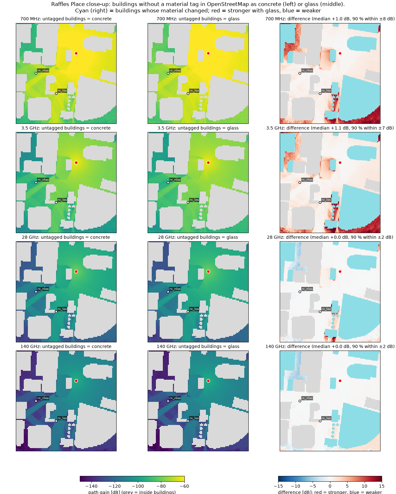

At 700 MHz and 3.5 GHz glass buildings let the signal through: the streets behind them typically get 10–15 dB
more (up to 25 dB in places); about 7 % of the street area gains more than 10 dB. At 28 and 140 GHz the difference
almost disappears, because a ray through a building crosses at least two glass walls (about 7 dB each at 28 GHz,
more at 140 GHz), and that is too much.

Smooth walls (mirror-like reflections only) vs **twice as rough** walls (more diffuse scattering):

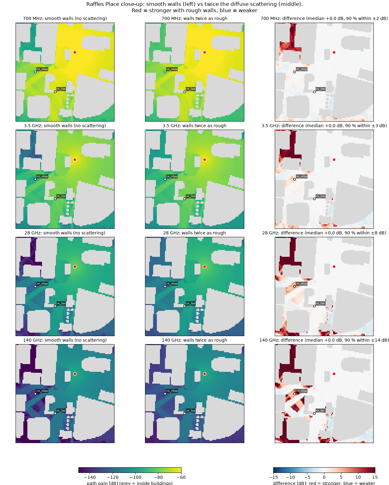

Here it's the other way round: roughness matters more the higher the frequency. The share of the street area that
gets more than 10 dB extra from rougher walls grows from 4 % at 700 MHz to 9 % at 28 GHz and 13 % at 140 GHz: in
side streets that smooth, mirror-like walls leave almost dark, the scattered signal from rough walls is what
arrives (red). A few spots that a mirror reflection used to reach get slightly weaker (blue, a few dB).

**Try it yourself:**

```bash
uv run scripts/material_lab.py configs/material_lab.toml
```

(about 20 seconds; results in `outputs/material_lab/latest/`). Change the wall size, the transmitter position or
the bands in `configs/material_lab.toml`. The city close-ups are drawn from the sensitivity study (no new
simulation):

```bash
uv run scripts/material_closeup_city.py outputs/sensitivity/sg_raffles_place/20260927-220101
```

### 12.8 The wide-area example: the whole Downtown Core with a network of sites

Everything above zooms into 600 m around Raffles Place. The second example covers **2 km × 2 km**: from Boat
Quay and the Padang to Marina Bay Sands and Gardens by the Bay. In the viewer, choose
**sg_downtown_core** in the *Simulation run* list.

What is in it:
* **About 1,500 buildings** from OpenStreetMap, and **water**: Marina Bay, the Singapore River and part of the
  Kallang Basin are a real water surface (0.86 km²), not concrete. Water reflects radio waves strongly, almost
  like a mirror, so the bay behaves differently from the streets (see the Developer Guide §10 for the water
  model).
* **A network of 9 rooftop sites, 3 sectors each (27 transmitters)**, about 500 m apart, which is typical for a
  dense city core. Each site stands on a 25–100 m roof (operators use mid-rise roofs, not the tops of 250 m
  towers), and each sector sits at the edge of its roof facing outwards, as real antennas do. The sites were
  placed by a script (`scripts/suggest_sites.py`) that mimics how a planner lays out a network.
* **12 receivers at places you know**, found by name in OpenStreetMap: Raffles Place, Boat Quay, Merlion Park,
  the Esplanade, Clifford Pier, Lau Pa Sat, Marina Bay Financial Centre, Bayfront Event Plaza, the Marina Bay
  Sands promenade, the ArtScience Museum, the Singapore Flyer, and a water taxi in the middle of the bay.
* **Three bands**: 700 MHz, 1.8 GHz and 3.5 GHz (the macro layers). Every phone connects to the strongest
  sector, as a real phone would.

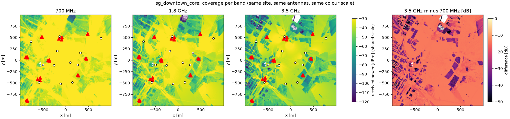

Red triangles are the sites (the three sectors of a site sit at different edges of its roof), white dots the
receivers.

Signal at the receivers (dBm):

| receiver | 700 MHz | 1.8 GHz | 3.5 GHz |
|---|---|---|---|
| Raffles Place | −20 | −30 | −37 |
| Boat Quay | −33 | −44 | −51 |
| Merlion Park | −17 | −26 | −32 |
| Esplanade | −22 | −31 | −37 |
| Clifford Pier | −15 | −23 | −29 |
| Lau Pa Sat | −24 | −32 | −37 |
| Marina Bay Financial Centre | −23 | −31 | −37 |
| Bayfront Event Plaza | −25 | −34 | −39 |
| Marina Bay Sands promenade | −25 | −33 | −39 |
| ArtScience Museum | −25 | −33 | −39 |
| Singapore Flyer | −23 | −31 | −37 |
| water taxi on the bay | −20 | −29 | −35 |

How to read it:
* **With a proper network, every place is covered.** 99.6 % of the outdoor area has usable signal (SNR above
  0 dB) even at 3.5 GHz; the weakest spot of the twelve is Boat Quay, in the narrow riverside streets.
* **The bands still differ**: 13–18 dB between 700 MHz and 3.5 GHz at the receivers, 30–50 dB behind buildings
  (the right-hand difference map), but with a site every 500 m even 3.5 GHz stays strong. That is why operators use more sites for higher bands.
* **Open water carries the signal far**: the whole bay is yellow, and the water taxi receives signal from many
  directions (the longest echoes of all receivers, about 0.5 µs), because the water and the waterfront facades
  reflect it.
* **Caution: no interference yet.** The signal-to-noise ratios in the viewer (36–82 dB) are far higher than any
  real phone would see, because the simulation doesn't count the other sites' signals as interference. In a real
  network, a phone between two sites hears both, and that is what limits speed. Adding interference (SINR) is a
  possible next step.

**In 3-D, with the dark view.** The same *3-D coverage* controls as for Raffles Place work here (section 12.6):
coverage shells at −45 / −35 / −25 dBm, the signal map floating at any height from 1.5 to 150 m, and the
**dark view**. The volume uses 8 m boxes instead of 4 m because the area is 16 times larger. The levels are
higher than for the single Raffles macro because a whole network is much stronger everywhere.

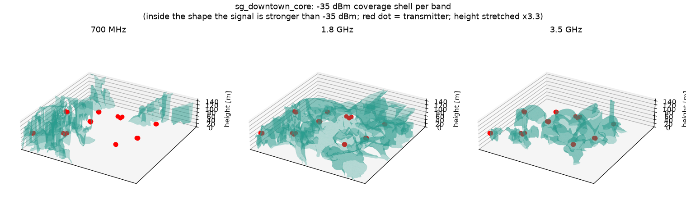

The −35 dBm shell (height stretched ×3.3 in this picture only, so it isn't a flat sheet): at **3.5 GHz** it is a
set of separate bubbles, one around each site; at **1.8 GHz** they grow and merge into one network; at
**700 MHz** almost all the air is stronger than −35 dBm, so the surface only outlines the few weaker pockets
behind towers. A west-east cut through the middle (Fullerton on the left, the bay in the middle,
Marina Bay Sands on the right; grey = inside buildings):

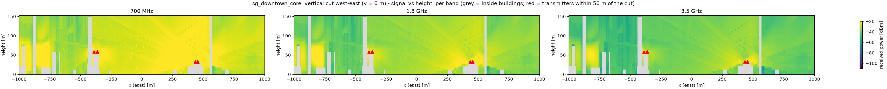

Above the bay the signal stays strong up to 150 m at every band, while behind the towers it drops.

**Tips for the viewer:** the area is 16 times larger than Raffles Place, so use **Top view** first, then zoom in.
With 12 receivers the ray paths get busy: untick receivers in the list to show only the ones you want (the dark
view hides them anyway).

**Run it yourself** (about 16 minutes on the RTX 5080: 8 for the maps, 8 for the 3-D volume):

```bash
uv run scripts/run_experiment.py configs/sg_downtown_core.toml
```

```bash
uv run scripts/export_geo.py outputs/sg_downtown_core/latest
```

To build the same kind of example for **another area**: make the scene (`--size` sets the side of the square in
metres), let the script suggest sites, then copy its output into a config file (copy
`configs/sg_downtown_core.toml` and replace the `[[transmitters]]` and `[[receivers]]`):

```bash
uv run scripts/make_osm_scene.py --name my_area --lat 1.2851 --lon 103.8561 --size 2000
```

```bash
uv run scripts/suggest_sites.py scenes/my_area --isd 500
```

## 13. Changing the experiment yourself

All changes go into the text file `configs/munich_frequency.toml`. Tip: copy it first, so the original stays
intact:

```bash
cp configs/munich_frequency.toml configs/my_test.toml
```

Edit `configs/my_test.toml` (for example in Windows Notepad via the `\\wsl.localhost\…` path, or with
`nano configs/my_test.toml` inside Ubuntu), then run it:

```bash
uv run scripts/run_experiment.py configs/my_test.toml
```

**Also give it its own name** in the file (`name = "my_test"` under `[experiment]`), so the results go to their
own folder.

Things to try:

* **Different bands:** change `ghz = [3.5, 28.0]` to e.g. `ghz = [3.5, 6.0, 28.0]`.
* **Move a receiver:** change a `position = [x, y, height]`. Numbers are metres from the centre of the map;
  the map spans −250 to +250 in x and y.
* **Stronger/weaker transmitter:** change `power_dbm` (every +3 dBm doubles the power).
* **Another built-in city:** set `source = "builtin:etoile"` (Paris, Arc de Triomphe) or
  `"builtin:san_francisco"`, then adjust the positions and camera to fit that city.
* **700 MHz (a low band):** this needs a special switch, because the official material data only starts at
  1 GHz. The results are then estimates, and the run is marked with a warning:

```bash
uv run scripts/run_experiment.py configs/munich_frequency.toml --bands 0.7 3.5 28 --extrapolate-materials
```

* **Singapore:** edit `configs/sg_raffles_place.toml` the same way. The `[mobility]` section sets the route
  (`waypoints`: start and end points in metres east/north of the centre, plus height), the speed and the number
  of snapshots. To check a new route stays on the street, and to get receiver suggestions for a new transmitter
  spot:

```bash
uv run scripts/suggest_layout.py scenes/sg_raffles_place/scene.xml --tx 20 0 12 --route -23 -148.6 3 3.1 150.3 3
```

* **Another place in the world:** see the [rebuild manual](REBUILD_FROM_ZERO.md) §7.

## 14. What a simulation can and cannot tell you

* **Simplified city.** Buildings are smooth blocks: no windows, trees, cars, people or street furniture. Real
  signals would see more scattering and blocking.
* **Material data has limits.** Materials use standard average values, and only within their official
  frequency ranges.
* **Rays are sampled.** The radio map is built from random rays, which is why far-away streets show speckled
  dots instead of smooth colour. More rays = smoother (but slower).
* **Antennas are idealised.** Isotropic antennas make comparisons clean; real base stations use directional
  antennas and beams.
* **Timings aren't benchmarks.** Speeds measured inside WSL aren't representative (the Mitsuba developers say
  so explicitly). Use them only as a rough guide.
* **Built-in cities have no map coordinates.** They can't be placed on a real globe; that's why the Singapore
  model is built from real map data.
* **Generated city models are simplified:** flat roofs, no terrain, one material (concrete) for all buildings,
  and heights taken from map tags (some estimated). Real glass towers would reflect differently at 28 GHz.
* **Movement is a series of snapshots**, every 5 m here. Anything that happens between two snapshots (a very
  short blockage) isn't seen; more snapshots give a smoother picture.

Use the simulation for **comparisons and understanding** ("which band covers more?", "which street is in
shadow?"), not as a guarantee of the exact signal at one spot.

## 15. When something goes wrong

| What you see | What it means | What to do |
|---|---|---|
| `The token '&&' is not a valid statement separator` | you typed a Linux command into Windows PowerShell | enter Ubuntu first: `wsl -d Ubuntu-24.04` |
| `No such file or directory` for `./setup.sh` | you're not in the project folder | `cd ~/projects/sionna-stack` |
| `Permission denied` for `./setup.sh` or `./scripts/…` | the file lost its "may run" flag (can happen after editing from Windows) | `chmod +x setup.sh scripts/*.sh` or run it as `bash setup.sh` |
| setup/verify says `LLVM (CPU)` and `CUDA/OptiX unavailable` | the graphics card path isn't working (typically after a Windows graphics driver update) | everything still works, just slower. To restore the GPU, see the [rebuild manual](REBUILD_FROM_ZERO.md) §6 |
| `Properties of ITU material '...' are not defined for this frequency` | the band is outside the material data range | use a band between 1 and 40 GHz, or add `--extrapolate-materials` |
| Jupyter link doesn't open | JupyterLab isn't running any more, or the port is taken | restart `./scripts/jupyter.sh`; copy the *new* link |
| `wsl -d Ubuntu-24.04` hangs | Ubuntu is stuck | in PowerShell: `wsl --terminate Ubuntu-24.04`, then try again. **Don't** use `wsl --shutdown`: it would also stop Docker/AODT |
| Viewer says "No exports found" | nothing converted for the map yet | `uv run scripts/export_geo.py outputs/sg_raffles_place/latest`, then reload the page |
| Viewer page doesn't open | the viewer isn't running | start `./scripts/viewer.sh` and keep that window open |
| Viewer map is dark / grey | map tiles still loading, or no internet in OpenStreetMap mode | wait a few seconds; offline, choose "Natural Earth (offline)" |
| New run not in the viewer's list | not exported yet | export it, then reload the page |
| `... is not georeferenced` when exporting | you exported a Munich (built-in) run | only real-map scenes (Singapore) can go on the globe |

## 16. Glossary

| term | meaning |
|---|---|
| **AODT** | NVIDIA Aerial Omniverse Digital Twin, another (separate) radio simulation platform on this PC |
| **band** | a range of radio frequencies used for one service |
| **CesiumJS** | free software that draws a 3-D globe in a web browser (used by the viewer) |
| **CZML** | Cesium's file format for things on the globe that can change over time (paths, the moving TX) |
| **Doppler shift** | small frequency change caused by movement; grows with speed and frequency |
| **extrude** | turn a flat building outline into a 3-D block of a given height |
| **georeferenced** | the model's coordinates are tied to real latitude/longitude |
| **OpenStreetMap (OSM)** | free, community-made world map; source of the Singapore buildings |
| **snapshot** | one complete simulation at one moment (one transmitter position) |
| **CUDA** | NVIDIA's way of running general computations on the graphics card |
| **dB / dBm** | logarithmic ratio / power relative to 1 milliwatt (see §2.7–2.8) |
| **delay spread** | how spread out in time the multipath arrivals are |
| **diffraction** | bending of a wave around an edge; weaker at higher frequency |
| **Dr.Jit** | the compiler under Mitsuba that turns simulation code into GPU or CPU programs |
| **GPU / CPU** | graphics card / main processor |
| **ITU-R P.2040** | international standard giving radio properties of building materials |
| **Jupyter / notebook** | a browser page mixing text, code and results |
| **LLVM** | the compiler used for the CPU fallback |
| **LOS / NLOS** | line of sight / blocked line of sight |
| **mmWave** | "millimetre wave", frequencies above ~24 GHz, like 28 GHz |
| **Mitsuba 3** | the ray-tracing engine Sionna is built on |
| **multipath** | receiving the same signal via several routes |
| **OptiX** | NVIDIA's GPU ray-tracing engine (what makes ray tracing fast on RTX cards) |
| **path gain** | fraction of transmitted power arriving via a path (in dB, negative) |
| **radio map** | heat map of signal strength over an area |
| **ray tracing** | simulating waves as many straight rays that bounce and bend |
| **Sionna / Sionna RT** | NVIDIA's open-source library for radio simulation / its ray-tracing part |
| **Ubuntu** | the Linux version used here (24.04) |
| **uv** | the tool that installs the exact Python library versions from the lock file |
| **WSL2** | Windows Subsystem for Linux: runs Linux inside Windows |
